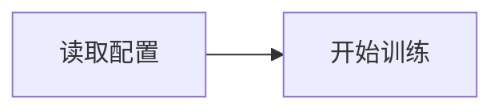

# 阿木木的技术博客

一个使用 Nuxt 4 和 Nuxt Content 构建的静态个人技术博客，用于记录学习、工程实践与科研过程。

## 已有功能

- 首页、博客列表、文章详情、Wiki、关于页面和 404 页面
- Markdown 博客文章与 Wiki 知识条目
- 全站搜索、深色模式及主题偏好持久化
- 左侧文章目录、移动端折叠目录、上一篇/下一篇导航
- 代码块横向滚动、主题适配和复制按钮
- 响应式布局，支持桌面端与移动端
- favicon、基础 SEO、静态站点生成
- 博客与 Wiki 共用轻量内容摘要查询层
- GitHub Actions 自动构建与静态产物检查
- 静态部署，不需要独立后端或数据库服务

## 技术栈

- Nuxt 4
- Vue 3
- Nuxt Content 3
- TypeScript
- Markdown
- CSS Variables

## 架构概览

```text
Markdown 内容
    -> Nuxt Content 构建时解析
    -> 内容查询层生成轻量摘要
    -> Nuxt 页面预渲染
    -> .output/public 静态文件
```

文章详情按需读取完整 Markdown AST，首页和列表页使用轻量摘要。搜索页通过 Nuxt Content 的 `queryCollectionSearchSections()` 在静态生成时提取博客与 Wiki 的章节标题和正文，并结合文章元数据生成搜索索引，随静态页面数据加载到浏览器。

搜索采用文章级 AND 匹配，空格分隔的全部关键词可以分布在不同章节，忽略英文大小写并去除重复关键词。文章按标题完全匹配、标题命中词数、最佳章节标题命中词数、简介命中词数、最佳章节命中词数依次排序，同分按 URL 排序。章节只根据自身标题和正文匹配，按命中词数、章节标题完全匹配、标题命中词数和正文命中词数依次排序，同分保留原文顺序。每篇文章仅显示一个结果及最多三个去重的相关章节，摘要与高亮来自实际命中位置。支持中文、英文和 `C++`、`&&`、`||` 等字面字符。

不需要自建搜索接口或数据库服务。Nuxt Content 在客户端导航等场景下可能使用浏览器端 WASM SQLite 执行内容查询。阅读次数暂未接入统计服务。

## 本地运行

推荐使用 Node.js 22。使用 Anaconda 创建环境：

```bash
conda create -n nuxt-blog -c conda-forge nodejs=22 -y
conda activate nuxt-blog
npm install
npm run dev
```

浏览器访问终端显示的地址，通常是 <http://localhost:3000>。

规范链接使用正式域名 `https://www.muhuacang.cn`。构建已提供默认值，如设置 `NUXT_PUBLIC_SITE_URL`，请使用同一域名。

## 内容位置

- 博客文章：`content/posts/*.md`
- Wiki 条目：`content/wiki/*.md`
- 页面：`app/pages/`
- 主题变量：`app/assets/css/theme.css`
- 样式入口：`app/assets/css/app.css`；基础、布局、公共组件、页面与正文分别位于同目录的 `base.css`、`layout.css`、`components.css`、`pages.css`、`content.css`。
- 站点 SEO：`app/utils/seo.ts`
- 静态检查：`scripts/check-static-output.mjs`

## 技术文章写法

博客和 Wiki 使用相同的 MDC 语法。提示支持 `note`、`tip`、`warning`、`important`，可包含列表、链接和行内代码。

````md
::callout{type="tip"}
运行前检查 `config.yaml` 中的数据路径。
::

::code-tabs
#python
```python [train.py]
print("ready")
```

#cpp
```cpp [main.cpp]
int main() { return 0; }
```
::


````

单独的代码围栏也支持方括号文件名。Mermaid 使用站点主题，支持 `accTitle` 作为图片说明。内嵌配置会触发源码降级。更多示例见 [阅读组件测试样例](tests/fixtures/reading.md)。

## RSS 与索引

读者可从页脚或阅读器订阅 [博客 RSS](https://www.muhuacang.cn/rss.xml)。[Sitemap](https://www.muhuacang.cn/sitemap.xml) 收录公开博客和 Wiki。新增文章后重新静态生成即可更新两份文件。仅供验证的内容可在 Frontmatter 设置 `seo: { robots: "noindex, follow" }` 退出收录。

博客的 `date` 表示发布日期。RSS 按规范将日期编码为当天 00:00 GMT。博客和 Wiki 的 `updated` 用于结构化数据和 Sitemap 的修改日期，缺少该字段时省略修改日期。

## 构建

```bash
npm ci
npm test
npm run typecheck
npm run build
npm run generate
npm run check:static
```

静态生成结果位于 `.output/public/`。

GitHub Actions 会自动执行单元测试、类型检查、生产构建、静态生成、HTML/XML 检查和浏览器回归。正式部署仍然只需要发布 `.output/public/`，不需要运行 Node.js 服务。

使用 `npm run typecheck` 检查 TypeScript 和 Vue 模板。`npm test` 覆盖全文搜索、目录、阅读进度及 Sitemap、RSS、Canonical 和 JSON-LD 的生成规则。安装 Chrome 后可用 `npm run test:browser` 验证静态页面交互，或设置 `CHROME_BIN` 指向本机 Chromium。浏览器测试从临时目录生成含样例的站点。
