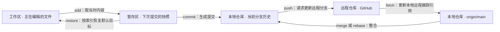
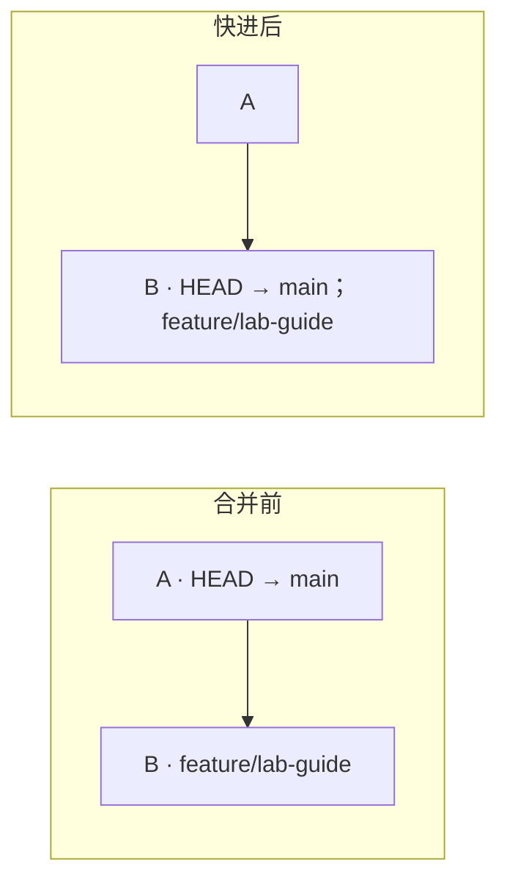
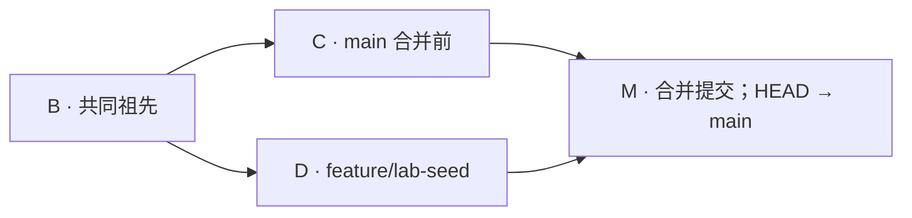
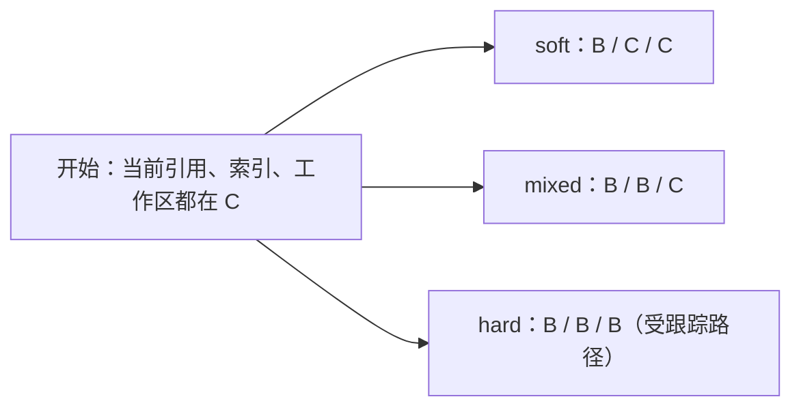
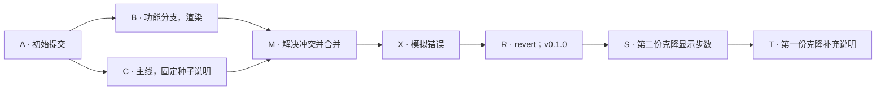

# Git 从零基础到熟练使用

适用环境为 Ubuntu 22.04 LTS、Bash、VS Code 和 GitHub。主线项目是一个用 Python 标准库实现的表格型 Q-learning 网格导航实验。你会从第一份提交开始，观察一份修改怎样经过暂存、提交、分支合并和推送，以及怎样在出错时把它恢复回来。

先走完第 1–4 章，保留第 2 章创建的主仓库。第 3、5、6、7、9 章的操作练习使用独立克隆，第 12 章回到主仓库，串起功能开发、冲突、回退、发标签和第二份克隆同步。只想先跑一遍的读者，可以按第 12 章的准备步骤开始。

主仓库路径为 `~/git-lab/grid-q-learning`。指令块按节依次执行，遇到预期之外的报错先检查。切换终端后，需要重新定位目录，必要时重新赋值。示例中的提交哈希以你的实际输出为准。流程图需要支持 Mermaid 的 Markdown 查看器，图旁也有文字或 ASCII 说明。

## 目录

1. [Git 基础知识](#ch01)

    [1.1 Git、GitHub 与版本控制](#sec-1-1) · [1.2 四个位置与一次提交的形成](#sec-1-2) · [1.3 Commit、分支和 HEAD](#sec-1-3) · [1.4 操作示例](#sec-1-4)

2. [Git 安装与初始化](#ch02)

    [2.1 在 Ubuntu 22.04 安装和更新](#sec-2-1) · [2.2 提交身份、配置范围与优先级](#sec-2-2) · [2.3 创建第一个 Python 仓库](#sec-2-3) · [2.4 在 VS Code 打开仓库](#sec-2-4)

3. [Git 日常操作](#ch03)

    [3.1 `git status` · 检查位置与状态](#sec-3-1) · [3.2 `git add` · 暂存指定内容](#sec-3-2) · [3.3 `git commit` · 保存索引快照](#sec-3-3) · [3.4 `git log` · 查看祖先历史](#sec-3-4) · [3.5 `git diff` · 明确比较两端](#sec-3-5) · [3.6 `git show` · 查看提交或对象](#sec-3-6) · [3.7 `git rm` · 删除已跟踪文件并暂存](#sec-3-7) · [3.8 `git mv` · 移动文件并暂存路径变化](#sec-3-8) · [3.9 `git restore` · 按来源恢复文件版本](#sec-3-9) · [3.10 `git reset` · 修改索引或移动当前引用](#sec-3-10)

4. [GitHub 远程仓库管理](#ch04)

    [4.1 建立空仓库](#sec-4-1) · [4.2 HTTPS、SSH 与提交身份](#sec-4-2) · [4.3 生成、添加和测试 SSH Key](#sec-4-3) · [4.4 添加远程和完成首次推送](#sec-4-4) · [4.5 用 fetch、pull、push 管理同步](#sec-4-5) · [4.6 从远程克隆并持续同步](#sec-4-6)

5. [分支管理](#ch05)

    [5.1 分支的职责](#sec-5-1) · [5.2 创建、切换与快进](#sec-5-2) · [5.3 三方合并与冲突](#sec-5-3) · [5.4 merge 与 rebase](#sec-5-4)

6. [版本回退与错误恢复](#ch06)

    [6.1 撤销未提交修改](#sec-6-1) · [6.2 amend 最近的本地提交](#sec-6-2) · [6.3 用 revert 撤销提交并保留历史](#sec-6-3) · [6.4 reset 的三种模式](#sec-6-4) · [6.5 reflog 与真实项目的恢复顺序](#sec-6-5)

7. [`.gitignore` 文件](#ch07)

    [7.1 工作原理与匹配](#sec-7-1) · [7.2 Python 和 C++ 的模板](#sec-7-2) · [7.3 只跟踪数据目录的一部分](#sec-7-3) · [7.4 停止跟踪文件并保留本地副本](#sec-7-4)

8. [团队协作与 GitHub 工作流](#ch08)

    [8.1 Fork、Clone、Branch、Pull Request](#sec-8-1) · [8.2 从分支到 PR](#sec-8-2) · [8.3 保持主线和功能分支同步](#sec-8-3) · [8.4 Issues、分支约定与提交消息](#sec-8-4)

9. [Git 进阶功能](#ch09)

    [9.1 stash · 暂存未完成的工作](#sec-9-1) · [9.2 cherry-pick · 选择性移植提交](#sec-9-2) · [9.3 tag · 标记发布位置](#sec-9-3) · [9.4 交互式 rebase · 整理未共享的提交](#sec-9-4) · [9.5 bisect · 二分查找回归](#sec-9-5) · [9.6 worktree · 同一仓库的多个工作目录](#sec-9-6) · [9.7 clean · 删除未跟踪文件](#sec-9-7) · [9.8 Hooks · 给关键操作加自动检查](#sec-9-8) · [9.9 Git LFS 和机器学习项目](#sec-9-9)

10. [Git 常见报错及解决方法](#ch10)

    [10.1 `src refspec main does not match any`](#error-01) · [10.2 `fatal: not a git repository`](#error-02) · [10.3 `nothing to commit, working tree clean`](#error-03) · [10.4 `non-fast-forward`](#error-04) · [10.5 `Permission denied (publickey)`](#error-05) · [10.6 `Connection closed by remote host`](#error-06) · [10.7 `Your local changes would be overwritten by merge`](#error-07) · [10.8 `detached HEAD`](#error-08) · [10.9 `merge conflict`](#error-09) · [10.10 `fatal: refusing to merge unrelated histories`](#error-10)

11. [Git + VS Code 实战](#ch11)

    [11.1 打开项目并观察状态](#sec-11-1) · [11.2 用图形界面提交，再对照终端](#sec-11-2) · [11.3 切换分支和查看历史](#sec-11-3) · [11.4 用合并编辑器解决冲突](#sec-11-4) · [11.5 图形操作和命令语义对照](#sec-11-5) · [11.6 常用扩展](#sec-11-6)

12. [完整项目实战](#ch12)

    [12.1 创建项目、配置忽略并完成首次提交](#sec-12-1) · [12.2 创建 GitHub 仓库并推送基线](#sec-12-2) · [12.3 在功能分支实现网格渲染](#sec-12-3) · [12.4 在主线制造并解决一次真实冲突](#sec-12-4) · [12.5 用 revert 撤销错误提交](#sec-12-5) · [12.6 标记版本并发布](#sec-12-6) · [12.7 在第二台电脑克隆，或模拟第二个工作位置](#sec-12-7) · [12.8 往返同步，观察 fetch 与快进的区别](#sec-12-8)

13. [附录 A · Git 常用命令速查表](#appendix-a)
14. [附录 B · 常见错误排查速查表](#appendix-b)
15. [附录 C · 推荐的 Git 日常工作流程](#appendix-c)

<a id="ch01"></a>
## 第一章 · Git 基础知识

**学习目标**　区分文件状态与分支位置，能解释一次提交里有什么，以及提交何时会出现在 GitHub。

<a id="sec-1-1"></a>
### 1.1 Git、GitHub 与版本控制

版本控制把项目的重要状态保留为历史。代码出现回归时，可以比较两次修改、定位引入问题的提交，也可以让两个人并行修改同一份项目。**Git** 是运行在本机上的分布式版本控制工具。**GitHub** 托管 Git 仓库，并提供 Pull Request（合并请求）、Issues（问题与任务记录）、权限、自动检查等协作功能。提交、查看历史、开分支可以离线完成。把提交传到 GitHub 需要网络和相应权限。

| 模型 | 历史通常保存在哪里 | 典型操作 |
| --- | --- | --- |
| 集中式，如 Subversion | 中央服务器保有主要历史，客户端维护工作副本 | 一般连接中央服务器提交和查询完整历史 |
| 分布式，如 Git | 普通克隆包含所获取的历史和对象，可独立提交 | 本地提交，再与选定的远程交换提交 |

浅克隆可只取部分历史，部分克隆可延迟获取对象。普通推送备份的是成功推送的引用及其可达历史。未提交文件、未推送分支、保存在本地 stash 的临时修改和外部数据各有自己的备份需求。参阅 [Pro Git · 关于版本控制](https://git-scm.com/book/en/v2/Getting-Started-About-Version-Control)。

<a id="sec-1-2"></a>
### 1.2 四个位置与一次提交的形成

| 位置 | 保存的内容 | 问自己 |
| --- | --- | --- |
| 工作区（working tree） | VS Code 和终端实际读写的项目文件 | 我现在编辑出的样子是什么？ |
| 暂存区（index，也称索引） | 下一份提交的候选快照，记录路径及其内容版本 | 下次提交会包含什么？ |
| 本地仓库 | 已保存的对象、分支引用、配置等，普通仓库位于项目的 `.git` | 我本机已有哪段历史？ |
| 远程仓库 | GitHub 或另一位置保存的对象和引用 | 队友能从哪里取得最新提交？ |

`git add` 会读取文件当时的内容并更新索引。之后继续编辑同一个文件，新内容只在工作区，直到再暂存。普通 `git commit` 从索引生成快照并移动当前分支。提交之后，索引通常与新 `HEAD` 的快照一致，工作区中未暂存的修改仍保留。`git push` 请求服务端接收对象并更新远程引用。`git fetch` 下载对象并更新本地的远程跟踪引用，例如 `origin/main`。`origin/main` 是本机上次与远程通信所得的记录，查看它不会实时访问 GitHub。



<a id="sec-1-3"></a>
### 1.3 Commit、分支和 HEAD

提交（commit）记录目录快照、父提交、作者和提交者、时间及说明。作者表示改动的原作者，提交者记录创建这份提交对象的人。Git 用 **blob** 保存文件内容，用 **tree** 记录目录里的名字、权限类型与对象，用 **commit 对象** 连接一棵树和零个、一个或多个父提交。第一份提交通常没有父提交，普通提交通常有一个，合并提交常有两个。哈希是根据对象内容计算的标识，修改提交说明或父提交会生成不同的提交标识。快照可复用内容相同的对象。比较时，Git 再从选定的快照计算差异。

分支是指向某个提交的可移动引用。创建分支通常只加一个引用。`HEAD` 通常指向当前本地分支。切换分支会令 `HEAD` 指向另一分支，并在允许的情况下更新索引和工作区。查看标签（给某个版本固定的名字）或特定提交时，也可以让 `HEAD` 直接指向提交，这叫 **detached HEAD**。此时新提交会推进 `HEAD`，需要另建分支为它保留入口。

```text
提交前： HEAD → main → B → A
提交后： HEAD → main → C → B → A
另有 feature 仍指向 B，远程 main 也可以仍指向 B。
```

<a id="sec-1-4"></a>
### 1.4 操作示例

第 2 章完成首次提交后回来运行。`--show-toplevel` 找到工作区根目录。`symbolic-ref --short` 显示 `HEAD` 指向的短分支名。`cat-file -p` 以可读形式展示对象，观察树、作者与消息。首次提交没有 `parent` 行。

```bash
cd "$HOME/git-lab/grid-q-learning"
git rev-parse --show-toplevel
git symbolic-ref --short HEAD
git cat-file -p HEAD
```

### 常见问题

- **提交后 GitHub 没变化。** 提交已在本地。检查当前分支与远程目标，再按第 4 章推送。
- **为何一个文件既有暂存修改又有未暂存修改？** 它在暂存后被再次编辑。索引中的文件版本可能与工作区不同。

### 实践练习

1. 画出文件从保存到队友能拉取的四个位置，写出每条箭头对应的动作。
2. 首次提交后观察 `HEAD`、`main` 和已提交对象。解释为什么创建一条新分支不会复制整个项目。

<a id="ch02"></a>
## 第二章 · Git 安装与初始化

**学习目标**　装好 Git，确认提交身份，从已有 Python 文件建立首个可运行的仓库。

<a id="sec-2-1"></a>
### 2.1 在 Ubuntu 22.04 安装和更新

`apt update` 刷新软件包索引，`apt install` 安装 Git。更新时，`--only-upgrade` 要求只升级已安装的 Git，升级范围取决于 APT 当前可用的软件源和依赖。Ubuntu 22.04 的维护包可能保留上游版本号并回移修复。以本机输出核对候选版本和实际采用的二进制路径。

```bash
sudo apt update
sudo apt install git
git --version
command -v git
apt-cache policy git
```

已安装后要更新 Git 时运行以下两行。教程的本地演练可在 Git 2.34.1 和 Python 3.10 上运行。`switch` 和 `restore` 自 Git 2.23 起提供，更早的项目文档常用 `checkout` 承担切分支与覆盖文件两类操作。

```bash
sudo apt update
sudo apt install --only-upgrade git
```

<a id="sec-2-2"></a>
### 2.2 提交身份、配置范围与优先级

设置本人希望公开在提交中的名字和邮箱。若希望 GitHub 将提交归到自己的账户并保持邮箱隐私，从 GitHub 的 **Settings → Emails** 复制该账户显示的 noreply 地址。已有提交仍带有生成时的元数据。登录或推送用第 4 章的认证凭据。

```bash
read -r -p '提交显示名: ' git_author_name
read -r -p '提交邮箱: ' git_author_email
git config --global user.name "$git_author_name"
git config --global user.email "$git_author_email"
git config --global init.defaultBranch main
git config --get user.name
git config --get user.email
git config --list --show-origin --show-scope
```

`--global` 作用于当前用户。`--local` 作用于当前仓库，值通常保存在 `.git/config`。`--system` 作用于系统。通常同一单值键按系统、用户、仓库、单次运行配置逐级覆盖。`git -c` 只对这一条命令生效。`--get` 读有效值，`--show-origin` 与 `--show-scope` 显示来源与作用域。贴配置给他人前，先检查是否暴露私有 URL 或凭据。

在仓库中需要采用不同邮箱时，执行下面的设置。若要清除这项局部覆盖，可随后用 `--unset`，Git 再按其他层级查值。

```bash
cd "$HOME/git-lab/grid-q-learning"
read -r -p '此仓库的提交邮箱: ' project_email
git config --local user.email "$project_email"
git config --show-origin --get user.email
git config --local --unset user.email
```

该例在完成 2.3 后执行。另一个常见偏好是编辑器。已安装 VS Code 且 `code` 在路径上时，可用以下设置。`--wait` 让 Git 等待编辑器里的消息文件关闭，再读取修改后的内容。

```bash
git config --global core.editor 'code --wait'
```

<a id="sec-2-3"></a>
### 2.3 创建第一个 Python 仓库

| 选择 | 入口 | 初始化结果 |
| --- | --- | --- |
| 已有本地项目 | `git init` | 在目录内建立本地仓库，已有文件通常最初未跟踪，初始分支在首次提交后才有可推送的引用 |
| 已有带提交的远程项目 | `git clone` | 创建目标目录，获取历史，设置默认远程 `origin`，通常签出并跟踪远程默认分支 |

`git init` 之前先确认项目目录正确。若已有项目，用你自己的项目路径并检查上级仓库，避免意外建出嵌套仓库。这套演练使用一个全新的路径。下面的 Bash 块会新建三个项目文件和一个忽略文件，目标目录若已存在，先检查内容再继续。

```bash
mkdir -p "$HOME/git-lab"
mkdir "$HOME/git-lab/grid-q-learning" && cd "$HOME/git-lab/grid-q-learning"
```

只有上一块成功进入新目录时才执行下一块。`cat >` 把内容写入目标文件，`<<'分隔词'` 包住原样写入的多行内容。下面实现一个 4×4 网格。智能体从左上角出发，目标在右下角，撞墙或越界会留在原地。每步支付小代价，到达目标获得正奖励。Q 表记录每个「状态 × 动作」的估计回报。训练时部分动作随机探索，其他动作选择估计回报最高者。一次更新用当前奖励和下一状态的最高估计值来修正当前估计，终止时没有后续回报。

```bash
cat > grid_q.py <<'PY'
"""Train a small tabular Q-learning agent to navigate a grid."""

import random

SIZE = 4
START = 0
GOAL = SIZE * SIZE - 1
WALLS = frozenset({5})
ACTIONS = ((-1, 0), (0, 1), (1, 0), (0, -1))
MAX_STEPS = 64


def step(state, action):
    row, col = divmod(state, SIZE)
    dr, dc = ACTIONS[action]
    row, col = row + dr, col + dc
    if 0 <= row < SIZE and 0 <= col < SIZE:
        candidate = row * SIZE + col
        if candidate not in WALLS:
            state = candidate
    done = state == GOAL
    return state, 1.0 if done else -0.04, done


def greedy_action(values):
    return max(range(len(ACTIONS)), key=values.__getitem__)


def train(episodes=600, seed=7, alpha=0.25, gamma=0.95, epsilon=0.2):
    rng = random.Random(seed)
    q = [[0.0] * len(ACTIONS) for _ in range(SIZE * SIZE)]
    for _ in range(episodes):
        state = START
        for _ in range(MAX_STEPS):
            if rng.random() < epsilon:
                action = rng.randrange(len(ACTIONS))
            else:
                action = greedy_action(q[state])
            next_state, reward, done = step(state, action)
            target = reward if done else reward + gamma * max(q[next_state])
            q[state][action] += alpha * (target - q[state][action])
            state = next_state
            if done:
                break
    return q


def greedy_path(q):
    state = START
    path = [state]
    for _ in range(MAX_STEPS):
        state, _, done = step(state, greedy_action(q[state]))
        path.append(state)
        if done:
            break
    return path


if __name__ == "__main__":
    path = greedy_path(train())
    print("Greedy path:", path)
PY

cat > test_grid_q.py <<'PY'
import unittest

from grid_q import GOAL, START, WALLS, greedy_path, step, train


class GridTest(unittest.TestCase):
    def test_step_right_and_wall(self):
        self.assertEqual(step(START, 1), (1, -0.04, False))
        self.assertEqual(step(1, 2), (1, -0.04, False))

    def test_seeded_agent_reaches_goal(self):
        path = greedy_path(train(seed=7))
        self.assertEqual(path[0], START)
        self.assertEqual(path[-1], GOAL)
        self.assertTrue(WALLS.isdisjoint(path))


if __name__ == "__main__":
    unittest.main()
PY

cat > README.md <<'MD'
# Grid Q-learning

Demo: print the learned path.

Run with Python 3.10 or later. No external Python dependencies.
MD

cat > .gitignore <<'IGNORE'
__pycache__/
*.py[cod]
.venv/
.env
.pytest_cache/
/logs/
/runs/
/data/
/checkpoints/
IGNORE
```

先跑程序和测试。`-m unittest -v` 通过 Python 启动单元测试模块并打印用例名。`init -b main` 指定初始分支名。只暂存四个刚审查的文件。`--` 表示之后的参数是文件路径，避免与选项或其他参数混淆。`--cached` 在 `diff` 中查看暂存内容，`--stat` 输出文件统计。`-m` 传入一行提交说明。运行到最后，应看到单条提交且工作区干净。

```bash
python3 grid_q.py
python3 -m unittest -v
git init -b main
git status --short
git add -- .gitignore README.md grid_q.py test_grid_q.py
git diff --cached --stat
git commit -m "feat: add reproducible grid Q-learning baseline"
git status --short --branch
git log -1 --oneline
```

```text
初始化后：工作区有 4 个未跟踪文件 | 索引空 | main 尚无提交 | 无远程
暂存后  ：工作区内容照旧           | 索引有 4 个文件 | main 尚无提交
提交后  ：工作区 = 索引 = HEAD 快照 | HEAD → main → A | 无远程
```

首次提交前，`git diff` 默认比较工作区和索引，未跟踪文件通常不会出现。`status` 能列出这些文件。这里的测试确保一个固定种子能走到终点，并验证基本环境转移。这个结果只覆盖此环境与给定配置。

<a id="sec-2-4"></a>
### 2.4 在 VS Code 打开仓库

从项目根目录打开 VS Code。已有 GUI 时，也可用 **File → Open Folder** 选择目录。打开 **Source Control**，对照终端的分支与状态。VS Code 内置 Git 集成使用系统上的 Git，集成终端也能对同一仓库操作。参阅 [VS Code 源代码管理](https://code.visualstudio.com/docs/sourcecontrol/overview)。

```bash
cd "$HOME/git-lab/grid-q-learning"
code .
```

### 常见问题

- **Author identity unknown。** 先确认有效的名字和邮箱。改好配置后直接重试提交，通常原先暂存的内容还在。
- **文件夹里已有仓库。** 先找根目录并查看已有历史和远程。已从 GitHub 克隆的目录可以直接修改与提交。
- **安装了 VS Code 却找不到 `code`。** 用图形界面打开目录，并检查 VS Code 安装及终端的 `PATH`。

### 实践练习

1. 观察刚初始化、暂存和提交后的三次状态。用第 1 章命令查看首个提交对象。
2. 在 VS Code 打开项目，确认状态栏分支和终端输出一致。保持主仓库干净，下一章使用练习克隆。

<a id="ch03"></a>
## 第三章 · Git 日常操作

**学习目标**　能用状态、差异和历史定位修改，准确控制下一次提交包含的内容。

在同一个终端顺序执行本章的 Bash 块。先建立独立练习克隆。`mktemp -d` 创建唯一的空目录，克隆的 `origin` 会指向第 2 章的本地项目。本章全程只在这份练习克隆里操作。`-sb` 合用短格式和分支显示。

```bash
daily_lab=$(mktemp -d "$HOME/git-lab/daily.XXXXXX")
git clone "$HOME/git-lab/grid-q-learning" "$daily_lab"
cd "$daily_lab"
git status -sb
```

<a id="sec-3-1"></a>
### 3.1 `git status` · 检查位置与状态

语法是 `status` 后接可选的显示参数与路径。`--short`（`-s`）输出两列状态，第一列通常是索引相对 `HEAD` 的变化，第二列是工作区相对索引的变化。`-b` 加上分支和已知的上游信息。`-uall` 展开未跟踪目录里的文件。冲突状态另有含义，例如 `UU` 表示双方都修改了同一路径。

```bash
printf '\nTraining configuration: seed 7.\n' >> README.md
printf 'A temporary note for the Git lab.\n' > draft.md
git status
git status -sb
git status --short -uall
```

`printf` 输出文本，`>>` 追加，`>` 从头写入。预期看到 ` M README.md` 和 `?? draft.md`。文件变化来自前两行。`status` 本身不改变文件内容、暂存快照、分支或远程。它可刷新索引的文件状态缓存。上游领先和落后计数基于本地已有引用，需要 `fetch` 才能刷新远程视图。

<a id="sec-3-2"></a>
### 3.2 `git add` · 暂存指定内容

语法是 `add` 后接路径或选择模式。明确路径最容易审查。`-p` 按差异块交互暂存，块内可用 `y` 接受、`n` 跳过、`s` 在可拆时细分、`q` 退出。`-A` 无路径时覆盖全仓库的新增、修改和删除。`-u` 更新已跟踪文件的修改与删除，通常跳过新文件。`-n` 预览。

```bash
git add -n -- README.md draft.md
git add -- README.md draft.md
git status --short
printf 'The training loop is deterministic for this seed.\n' >> README.md
git status --short
```

先看到 `M  README.md`、`A  draft.md`，再次编辑后 README 变成 `MM`。这条命令更新索引，Git 可为新内容在本地写入 blob，`HEAD` 和远程引用保持原位。`add .` 的范围从当前目录递归展开。遇到忽略提示，先用第 7 章的方法检查规则。密钥、训练输出和机器专用配置应在暂存前识别出来。

这里把同一文件的三个内容版本简写成 A、B、C。文件从 B 又被编辑成 C，索引里的 B 保留到第 3.3 节。

```text
                         工作区       索引         HEAD 的 README    远程
开始                      A            A            A                A
第一次追加                B            A            A                A
暂存 B                    B            B            A                A
再次编辑                  C            B            A                A
第 3.3 节提交             C            B            B                A
```

<a id="sec-3-3"></a>
### 3.3 `git commit` · 保存索引快照

普通语法是 `commit` 加可选信息。`-m` 直接提供主题，省略它通常打开编辑器。`-a` 会先把已跟踪文件的当前修改和删除纳入，容易把本来分开暂存的修改一起提交，未跟踪文件仍需显式 `add`。`--amend` 替换最近一次提交，适用条件见第 6 章。

```bash
git diff --cached
git commit -m "docs: record training seed and add a lab note"
git status --short
```

README 的第一行追加内容和 `draft.md` 进入提交，README 后追加的第二行显示为 ` M`。Git 创建提交对象，当前分支前进，索引成为新的已提交快照，工作区仍有未暂存修改。远程和 `origin/main` 都在原来的位置。遇到没有内容可提交，先看 `status` 与暂存差异。若身份缺失，按第 2 章配置后重试。

<a id="sec-3-4"></a>
### 3.4 `git log` · 查看祖先历史

语法是 `log` 加可选的引用、范围、显示参数与文件路径。`--oneline` 用短哈希和主题显示。`-n 3` 限制三条，`--graph` 绘制分支图，`--decorate` 标出引用，`--all` 从本地所有引用查找，`-p` 附补丁。路径前使用 `--`。

```bash
git log -n 3 --oneline
git log --graph --oneline --decorate --all
git log -1 -p -- README.md
```

这是查询，四处状态内容保持原样。省略范围时默认从当前 `HEAD` 追溯。历史里没找到别的分支时，确认该分支已下载，然后指定引用或查看 `--all`。分页器中按 `q` 返回终端。

<a id="sec-3-5"></a>
### 3.5 `git diff` · 明确比较两端

语法是 `diff` 加可选快照、选项与路径。以下几种比较读取工作区、索引或提交，各处内容和引用均保持原位。`--stat` 看规模，`--name-only` 只列文件名。项目没有子模块等额外机制时可按下表理解。

| 参数组合 | 左端 → 右端 | 此刻的预期 |
| --- | --- | --- |
| 无比较参数 | 索引 → 工作区 | README 第二次追加 |
| `--cached`（`--staged` 同义） | `HEAD` → 索引 | 空，上一节已提交 |
| `HEAD` | `HEAD` → 工作区中的受跟踪路径 | README 第二次追加 |
| 两个提交 | 较早快照 → 较晚快照，顺序由你指定 | README 第一次追加 |
| `A...B` | A、B 的合并基点 → B | 常用来审查分支 B 相对分叉点的净变化 |

```bash
git diff -- README.md
git diff --cached
git diff HEAD -- README.md
git diff HEAD~1 HEAD -- README.md
```

`HEAD~1` 表示沿第一父提交回退一步。Git 差异一般跳过未跟踪文件。暂存了一半时，审查工作区差异和暂存差异两边，才能知道全部改动及实际要提交的内容。

<a id="sec-3-6"></a>
### 3.6 `git show` · 查看提交或对象

语法是 `show` 加可选的对象、显示选项与路径。默认看 `HEAD`，展示提交元数据和变化。`--stat` 看规模，`--format=fuller` 展示作者、提交者及对应时间。`提交:路径` 则读取该快照里的文件。四处状态内容保持原样。

```bash
git show --stat --format=fuller HEAD
git show HEAD -- README.md
git show HEAD:README.md
```

第三行只有第一次追加，没有工作区里的第二次追加。历史路径需使用当时的名字，`:` 后面的路径默认以仓库根为基准。遇到路径不存在可先查提交的文件列表。

<a id="sec-3-7"></a>
### 3.7 `git rm` · 删除已跟踪文件并暂存

语法是 `rm` 加可选选项和路径。默认同时删工作区文件和索引记录。`-n` 预览，`-r` 允许递归删除目录，`--cached` 只停止跟踪并保留本地文件。默认防护会拒绝某些有未提交修改的删除。强制参数 `-f` 会绕过防护。

**风险**　先审查状态、两份差异和预览。以下只删除练习文件 `draft.md`，它已出现在上一份提交中。

```bash
git status --short
git diff -- draft.md
git diff --cached -- draft.md
git rm -n -- draft.md
git rm -- draft.md
git status --short
git commit -m "docs: remove the temporary lab note"
```

删除后 `draft.md` 的状态为 `D `（第一列），旧提交和远程保持原位，直到后续提交或推送。普通文件系统删除只改变工作区，之后可暂存该删除。用 `--cached` 的协作影响见第 7 章。

<a id="sec-3-8"></a>
### 3.8 `git mv` · 移动文件并暂存路径变化

语法是 `mv` 加源路径和目标路径，可用 `-n` 预览。`-f` 可覆盖目标，先检查目标和已有修改。Git 的快照记录路径和内容，比较时根据内容相似度识别重命名。

```bash
git status --short
git mv -n -- README.md GUIDE.md
git mv -- README.md GUIDE.md
git status --short
git diff --cached --find-renames
git diff -- GUIDE.md
git commit -m "docs: rename the lab guide"
git status --short
```

工作区与索引的路径都改为 `GUIDE.md`。来自旧工作区的未暂存追加仍在新路径上，短状态通常为 `RM`。提交前，`HEAD` 与远程维持原位。提交后，索引含已重命名的文件，附加行仍只在工作区。目标存在时，先给它独立名称或保存已有内容。

<a id="sec-3-9"></a>
### 3.9 `git restore` · 按来源恢复文件版本

语法是 `restore` 加选项和路径。默认索引 → 工作区。加 `--staged` 默认从 `HEAD` 写回索引。加 `--source` 可明确指定来源，目标可用 `--worktree` 和 `--staged` 单独或合并选择。`-p` 允许按块处理。

**风险**　写工作区会覆盖未暂存内容。若指定来源没有某个被选中的受跟踪文件，恢复操作也可能移除该路径。先比较两份差异，需要保留就备份。下面的 `mktemp` 创建仓库外的备份文件，`cp` 保存完整的当前文件。打印的路径可用于重新打开副本。

```bash
git diff -- GUIDE.md
git diff --cached -- GUIDE.md
guide_backup=$(mktemp)
cp -- GUIDE.md "$guide_backup"
printf 'Backup: %s\n' "$guide_backup"
git restore -- GUIDE.md
git status --short

printf '\nA new practice line.\n' >> GUIDE.md
git add -- GUIDE.md
git restore --staged -- GUIDE.md
git status --short
```

第一次恢复后文件回到索引版本，状态干净。第二次恢复只取消暂存，练习行仍在工作区，显示 ` M GUIDE.md`。`HEAD` 和远程从头到尾保持原位。对 `??` 文件，先单独处理或备份，默认恢复依赖索引里的路径。

<a id="sec-3-10"></a>
### 3.10 `git reset` · 修改索引或移动当前引用

这个命令有两种入口。**带路径**时按指定提交重置索引中的路径，默认来源为 `HEAD`。**带提交且无路径**时移动当前分支（分离状态则移动 `HEAD`），再按模式决定是否同步索引和工作区。`--soft` 只移动引用，默认 `--mixed` 还重置索引，`--hard` 也会覆盖工作区。路径式取消暂存更常用 `restore` 的 `--staged`。

```bash
git add -- GUIDE.md
git diff --cached -- GUIDE.md
git reset -- GUIDE.md
git status --short

git add -- GUIDE.md
git commit -m "docs: add a practice line"
git branch backup/daily-before-soft
git status --short
git log -2 --oneline
git reset --soft HEAD~1
git diff --cached -- GUIDE.md
git status --short
```

第一种用法把 `M ` 变为 ` M`。第二种在练习克隆中撤回一份未推送提交，把 `main` 移回父提交，文件和索引内容保留，因此练习行又显示为已暂存。备份分支保留原提交。两种用法都不向远程发送任何数据。`--soft` 会改写本地分支历史。`--hard` 的覆盖范围和演练保护见第 6 章。

### 常见问题

- **暂存了上一版文件。** 先同时检查两份差异，再决定是否重新暂存全部内容或只选部分差异块。
- **状态里是删除加新增。** 核对路径和内容。差异检测可能在相似度不足时显示为删除加新增，这和快照是否保存正确是两件事。
- **提交时终端进入编辑器。** 保存并退出以提交。将消息留空并退出通常会中止普通提交。

### 实践练习

1. 在 `GUIDE.md` 制造两个相隔足够远的修改，用交互式暂存只添加其中一块，比较暂存与未暂存差异。
2. 分别说出路径式取消暂存、覆盖工作区和移动分支后，四个位置各自变化了什么。

<a id="ch04"></a>
## 第四章 · GitHub 远程仓库管理

**学习目标**　能从本地提交首次发布到 GitHub，理解上游关系，检查远程变化后再整合。

<a id="sec-4-1"></a>
### 4.1 建立空仓库

在 GitHub 右上角 **+ → New repository**，选择 Owner，填 `grid-q-learning`，按自己的需要选择 Private 或 Public。已有本地首提交时，新仓库保留为空，略过 README、许可证和 Git 忽略模板初始化。若远程已放入其他人写的内容，先按第 10.10 节检查双方历史。创建后从页面复制 HTTPS 或 SSH URL。参阅 [GitHub · 发布已有本地代码](https://docs.github.com/en/migrations/importing-source-code/using-the-command-line-to-import-source-code/adding-locally-hosted-code-to-github)。

<a id="sec-4-2"></a>
### 4.2 HTTPS、SSH 与提交身份

| 方式 | GitHub.com URL 形态 | 认证与适用情况 |
| --- | --- | --- |
| HTTPS | `https://github.com/OWNER/REPO.git` | 通常经 443 端口。可用 Git Credential Manager 的浏览器登录，或在命令行密码提示处提供有仓库写权限的个人访问令牌（PAT） |
| SSH | `git@github.com:OWNER/REPO.git` | 默认经 22 端口。把公钥加入 GitHub，在本机用私钥证明身份，适合长期开发 |

`OWNER` 和 `REPO` 是地址结构里的占位符，实际操作从 GitHub 复制完整地址。公开仓库用 HTTPS 读通常无需登录。GitHub 的 Git HTTPS 认证使用令牌或凭据管理器。避免把令牌写进 URL、脚本、仓库或终端参数。若用细粒度令牌，选对资源 Owner 和仓库，推送普通文件需要适用的 Contents 写权限。组织审批、SSO（单点登录）以及修改工作流文件可能还有额外要求。提交里的 `user.name` 与 `user.email` 是元数据。参阅 [GitHub · 远程地址](https://docs.github.com/en/get-started/git-basics/about-remote-repositories) 和 [GitHub · 个人访问令牌](https://docs.github.com/en/authentication/keeping-your-account-and-data-secure/managing-your-personal-access-tokens)。

<a id="sec-4-3"></a>
### 4.3 生成、添加和测试 SSH Key

仅在选择 SSH 时执行。先检查现有文件。若 `id_ed25519` 及对应公钥存在，并且打算使用这把钥匙，直接使用它。若已有文件但需要新密钥，用 `-f` 指定一个新的文件名，并在后续步骤使用同名路径。遇到覆盖提示请拒绝。

```bash
ls -la "$HOME/.ssh"
```

目录不存在时可继续生成。`-t ed25519` 选择密钥类型，`-C` 设可辨识的注释。交互提示输入保存路径，可按回车使用默认路径。建议给私钥设置口令。已有可用 SSH agent 时可跳过启动 agent 的行。`ssh-add` 将私钥加入 agent。

```bash
ssh-keygen -t ed25519 -C "GitHub on Ubuntu"
eval "$(ssh-agent -s)"
ssh-add "$HOME/.ssh/id_ed25519"
cat "$HOME/.ssh/id_ed25519.pub"
```

将最后一行输出的**公钥**整行复制到 GitHub **Settings → SSH and GPG keys → New SSH key**，作为认证密钥保存。无 `.pub` 后缀的私钥文件留在本机。首次连接检查 SSH 显示的**服务器**指纹，与 GitHub 公布的对应算法指纹一致后才接受。`-T` 禁用终端分配。成功消息会显示认证到的账户以及服务端不提供 shell 的提示。该测试即使认证成功也通常返回状态码 1。

```bash
ssh -T git@github.com
```

若使用非默认私钥，可通过 agent 加载对应文件。多账号更适合在 SSH 配置中给不同主机别名绑定 `IdentityFile`。遇到错误，用第 10.5–10.6 节区分密钥、权限和网络问题。参阅 [GitHub · 创建 SSH key](https://docs.github.com/en/authentication/connecting-to-github-with-ssh/generating-a-new-ssh-key-and-adding-it-to-the-ssh-agent)、[GitHub · SSH 指纹](https://docs.github.com/en/authentication/keeping-your-account-and-data-secure/githubs-ssh-key-fingerprints) 和 [GitHub · 测试 SSH](https://docs.github.com/en/authentication/connecting-to-github-with-ssh/testing-your-ssh-connection)。

<a id="sec-4-4"></a>
### 4.4 添加远程和完成首次推送

两种路线任选其一。`origin` 是惯用远程名。远程名保存 URL 和获取规则，可以随项目改变或增加其他远程。

**路线 A · GitHub。** 从刚建好的空仓库复制所选协议的 URL。`remote -v` 列各远程的读取和推送地址。`remote add` 添加本地配置，只在确实没有 `origin` 时执行。

```bash
cd "$HOME/git-lab/grid-q-learning"
git status --short --branch
git remote -v
read -r -p '粘贴 GitHub 仓库的 HTTPS 或 SSH URL: ' repo_url
git remote add origin "$repo_url"
```

**路线 B · 离线演练。** 在同一机器建立一个 **bare 仓库**。它有对象和引用，可以被推送和克隆，平时无工作区。提交经过的 Git 过程和 GitHub 类似，账号、权限、PR 和 Release 网页需在路线 A 实践。只在主仓库没有 `origin`、模拟远程目录还不存在时执行。

```bash
cd "$HOME/git-lab/grid-q-learning"
git remote -v
offline_remote="$HOME/git-lab/grid-q-learning-remote.git"
mkdir "$offline_remote" &&
    git init --bare -b main "$offline_remote" &&
    git remote add origin "$offline_remote"
```

**两条路线汇合。** 先确认远程 URL、当前分支和最新提交。`ls-remote --heads` 查询服务器的分支。空仓库通常无输出，出现认证错误先处理，已有分支先检查内容。`push -u` 成功时建立上游关系，通常使本地 `main` 跟踪 `origin/main`。上游是当前分支默认比较、拉取的分支。之后无参数推送是否成功还取决于 `push.default` 和远程设置。

```bash
git remote get-url origin
git branch --show-current
git log -1 --oneline
git ls-remote --heads origin
git push -u origin main
git branch -vv
git ls-remote --heads origin main
```

工作文件、索引和本地 `main` 的提交内容保持原样。远程首次得到对象和 `main`，本地通常建立 `origin/main` 并写入上游配置。若用 GitHub，在页面查看文件和最新提交号，再与本地日志核对。

已有 `origin` 但 URL 配错时，用以下方式改地址。确认给的是同一项目的目标地址。若先前设置过专门的 push URL，还需检查 `--push` 看到的值，按需用 `remote set-url --push` 修改。上游已经存在但想显式调整时，可先 fetch，之后用 `--set-upstream-to`，它只修改本地追踪配置。

```bash
git remote -v
git remote get-url --push origin
read -r -p '粘贴经过核实的目标仓库 URL: ' corrected_url
git remote set-url origin "$corrected_url"
git remote -v
```

下面适用于 `origin/main` 已存在的仓库。`remote show` 默认联系远程显示分支与跟踪关系，`-n` 使用缓存信息。`remote rename` 可以更名，`remote remove` 会移除本地配置及相应的远程跟踪引用，GitHub 仓库仍在服务器上。

```bash
git fetch origin
git branch --set-upstream-to=origin/main main
git remote show origin
```

<a id="sec-4-5"></a>
### 4.5 用 fetch、pull、push 管理同步

| 命令 | 工作区 | 索引 | 本地仓库 | 远程仓库 |
| --- | --- | --- | --- | --- |
| `fetch` | 通常保持 | 通常保持 | 取得对象、更新远程跟踪引用，当前分支保持 | 读取 |
| `pull` | 整合成功或发生冲突时可能更新 | 同左 | 先 fetch，再按选项和配置整合到当前分支 | 读取 |
| `push` | 保持 | 保持 | 当前分支保持，成功时可更新对应本地远程跟踪引用 | 请求写对象与目标引用 |

开始工作前，在干净的 `main` 上先取回信息。`--prune` 根据获取规则清理远程已删除的本地远程跟踪引用。`--left-right` 显示两边各自独有的提交。对 `main...origin/main`，`<` 属于本地，`>` 属于远程。若本地只落后，`merge --ff-only` 只在允许快进时推进本地 `main`，分叉时停下。确认后也可用 `pull --ff-only` 组合获取和快进。

```bash
git switch main
git status --short --branch
git fetch --prune origin
git log --left-right --oneline main...origin/main
git merge --ff-only origin/main
```

若只有本地领先，可在确认写权限、审查提交后推送。若两边都有独有提交，按第 10.4 节保存进度并选择整合方式。单纯反复推送不会整合远程提交。第一次推送失败时，先读完整错误，再核对 URL、账户、提交、权限及分支保护。SSH 认证成功表示 GitHub 已识别账户，写权限仍需单独确认。

<a id="sec-4-6"></a>
### 4.6 从远程克隆并持续同步

在独立练习目录演示，主仓库不动。默认克隆会将远程配置为 `origin` 并跟踪远程默认分支。以下从现有 `origin` 取 URL，适用于本章两条路线。`git -C` 让子命令在指定目录运行。确认当前仍为 `main` 后再做 `pull --ff-only`。

```bash
clone_url=$(git -C "$HOME/git-lab/grid-q-learning" remote get-url origin)
clone_lab=$(mktemp -d "$HOME/git-lab/clone.XXXXXX")
git clone "$clone_url" "$clone_lab"
cd "$clone_lab"
git branch -vv
git status -sb
git pull --ff-only
```

### 常见问题

- **`remote origin already exists`。** 查出现有 URL，确认确需纠正时用 `set-url`。向两个地方推送时可配置不同的远程名。
- **HTTPS 403 或提示仓库不存在。** 核对 Owner、仓库名、当前认证账户、令牌仓库范围和组织限制。私有仓库也可能给未授权访问者返回「找不到」。
- **远程已有 README。** 先查看两端是否共享历史。远程新建 README 与本地独立初始化常导致两条根历史，按第 10.10 节处理。

### 实践练习

1. 选一条远程路线发布首提交，比较本地 `main`、`origin/main` 与远程输出的提交号。
2. 在 4.6 的克隆里对照 `status`、`branch -vv` 和远程配置，找出它的默认同步分支。

<a id="ch05"></a>
## 第五章 · 分支管理

**学习目标**　用短生命周期分支隔离修改，区分快进、三方合并和变基，并能在冲突后安全完成或中止合并。

<a id="sec-5-1"></a>
### 5.1 分支的职责

| 名称约定 | 常见职责 | 何时采用 |
| --- | --- | --- |
| `main` | 稳定或可发布的主线 | 个人和小团队的默认主线 |
| `develop` | 统一集成并等待发布 | 团队确有独立发布节奏，需要单独的集成线时 |
| `feature/…` | 开发一个功能或一组相关修改 | 从最新目标分支创建，集成后结束生命周期 |
| `hotfix/…` | 修复生产或已发布版本的紧急问题 | 从实际生产基线分出，修复也要回到适用的开发线 |

名称属于团队约定，Git 对这些名称的功能一视同仁。小团队可从 `main` 加短功能分支开始，避免长期维护额外集成线带来的同步成本。

<a id="sec-5-2"></a>
### 5.2 创建、切换与快进

在独立克隆中按顺序完成本章操作。`branch 名称` 仅创建引用。`switch 名称` 切换当前分支。`switch -c` 将创建和切换合成一步。`branch -vv` 显示提交和上游。`branch -a` 会同时列本地和已获取的远程跟踪分支。

```bash
branch_lab=$(mktemp -d "$HOME/git-lab/branches.XXXXXX")
git clone "$HOME/git-lab/grid-q-learning" "$branch_lab"
cd "$branch_lab"
git branch feature/lab-guide
git branch -vv
git switch feature/lab-guide
printf '\nRun the test suite before publishing.\n' >> README.md
git add -- README.md
git commit -m "docs: explain when to run the test suite"

git switch main
git status --short
git merge --ff-only feature/lab-guide
git log --graph --oneline --decorate --all
```

切换时 `HEAD` 改指目标分支。在干净工作区，索引和工作区同步到目标快照。可能被覆盖的本地修改通常会让切换被拒。`--ff-only` 要求当前提交是目标的祖先，或所要合入的分支已经包含在当前历史中。演练中 `main` 从 A 前移到 B，没有新合并提交。远程保持原位。当前分支是**接收**合并的一方。



`branch --merged main` 列出末端已可从本地 `main` 到达的分支。确认分支已合入并切到其他分支后用 `-d` 删除本地分支。`-d` 会检查合并状态（有上游时以配置的上游为准，否则用 `HEAD`）。`-D` 关闭这项保护，可能移除未合入提交的唯一分支入口。删之前要检查独有提交并按需保留引用。下例只删演练的已合并分支。

```bash
git branch --merged main
git log --oneline main..feature/lab-guide
git branch -d feature/lab-guide
```

<a id="sec-5-3"></a>
### 5.3 三方合并与冲突

接着让两条线从 B 各自生成一份提交，修改不同文件。`--no-ff` 要求在可快进时也创建合并提交，`--no-edit` 接受默认合并说明。此处已经分叉，会使用共同祖先 B、当前分支末端 C 和待合并分支末端 D 来合成结果，称为三方合并。

```bash
git switch -c feature/lab-seed
printf '\nThe baseline uses seed 7.\n' >> README.md
git add -- README.md
git commit -m "docs: describe the baseline seed"

git switch main
printf 'Python 3.10 or later; standard library only.\n' > ENVIRONMENT.txt
git add -- ENVIRONMENT.txt
git commit -m "docs: describe the Python environment"
git merge-base main feature/lab-seed
git status --short
git merge --no-ff --no-edit feature/lab-seed
git log --graph --oneline --decorate --all
git rev-list --parents -n 1 HEAD
git branch -d feature/lab-seed
```

`merge-base` 查看合并基点。`rev-list --parents -n 1` 输出当前提交和它的父提交。M 有两个父提交 C 和 D，`HEAD` 经 `main` 指向 M，索引和工作区反映合并结果。`feature/lab-seed` 删除前仍指向 D，远程仍没有这些提交。



两个分支改到同一文本区域，或一方删除、一方修改同一路径时，Git 可能无法自动选择结果。冲突时 `HEAD` 暂留在 C，`MERGE_HEAD` 记录待合并的 D，索引为冲突文件保留多份输入，工作区的文本可能出现冲突标记。索引中的 stage 1、2、3 通常分别是基点、当前方和另一方。增删冲突有时缺少其中某一份。`git ls-files -u` 可检查这些记录。按第 12.4 节实做冲突。基本处理顺序如下。

1. 用 `status` 查未合并路径，并读两边的改动意图。
2. 编辑为想保留的完整版本，删掉标记。在 VS Code 可打开合并编辑器，审查 **Current**、**Incoming** 与 **Result**，也可以手写结果。
3. 运行测试，用 `add` 标记已解决的路径。检查暂存差异和未解决列表，再用 `merge` 的 `--continue` 或普通提交完成。
4. 若决定放弃合并，检查是否要保留你刚编辑的文件，先备份，再执行下面的中止命令。合并开始时工作区干净会让中止更可靠。

```bash
git status
git ls-files -u
# 仅在合并仍在进行、并准备放弃这次合并时执行
git merge --abort
```

<a id="sec-5-4"></a>
### 5.4 merge 与 rebase

| 操作 | 如何整合 | 历史效果 | 常用场景 |
| --- | --- | --- | --- |
| `merge` | 合并两条线的结果，或快进 | 保留原提交标识，三方合并可生成双亲提交 | 集成共享分支，保留合并点 |
| `rebase` | 将当前分支的相关提交依次重放到新基底 | 被重新创建的提交标识改变 | 整理尚未共享的本地功能分支 |

下面从三方合并 M 的第一父提交 C 新建一个功能分支，再把新提交 E 重放到 M 上。`HEAD^1` 指第一父提交。备份分支保留旧的 E。演练已删除前面的功能分支，提交仍在历史中。

```bash
git switch -c feature/lab-rebase HEAD^1
printf 'Compare the same seed across runs.\n' > EXPERIMENT.txt
git add -- EXPERIMENT.txt
git commit -m "docs: outline a reproducible experiment"
git branch backup/lab-rebase
git status --short
git rebase main
git log --graph --oneline --decorate --all
```

```text
原工作：  C → E   （backup/lab-rebase 指向 E）
主线：    C → M   （main 指向 M，图中省略 M 的另一父提交）
变基后：  C → M → E′  （HEAD → feature/lab-rebase）
```

变基会用新的索引和工作区重放每份提交。目标分支 `main` 和远程保持原位。冲突时变基暂停，解决后暂存，再继续。`--skip` 放弃当前正在重放的这份提交，必须先确认其改动已存在或确实应舍弃。`--abort` 尝试回到开始变基前，必要时先复制你正在编辑的文件。

```bash
git status
# 已逐个解决并暂存冲突文件后，继续
git rebase --continue
```

中止是继续的替代选项。命令用于变基正在进行时。

```bash
git status
git rebase --abort
```

### 常见问题

- **切换分支前 Git 提示会覆盖改动。** 先提交可保留的工作，或用第 9 章的 stash 暂存进度，再切分支。
- **我的功能分支推送了，变基后被拒。** 提交身份已改变。保留共享历史时用合并。确需更新独占分支时见第 6.5 节。
- **代码能自动合并，测试却失败。** 文本无冲突只说明 Git 找到文本合并结果。不同文件里的接口或业务规则仍可能不兼容。

### 实践练习

1. 用提交图指出快进后的 `main` 和三方合并后 M 的两个父提交。
2. 在练习克隆中尝试从旧基点分出两个分支修改同一行，回到接收分支合并，在 VS Code 组合出正确结果。需要精确命令时用第 12.4 节。
3. 比较备份分支和变基分支的提交号与净改动，解释何时要保留原提交标识。

<a id="ch06"></a>
## 第六章 · 版本回退与错误恢复

**学习目标**　先定位修改所在位置，再选择影响范围最小的恢复方法。能区分「移回去」「覆盖文件」和「新增反向提交」。

<a id="sec-6-1"></a>
### 6.1 撤销未提交修改

| 你要达到的状态 | 工具 | 写入方向 |
| --- | --- | --- |
| 取消暂存，保留正在编辑的内容 | `restore` 的 `--staged` | `HEAD` → 索引 |
| 只撤销一份文件的未暂存内容 | `restore` 默认模式 | 索引 → 工作区 |
| 取回旧提交里的某个文件 | `restore` 的 `--source` | 指定提交 → 所选索引或工作区 |
| 取消尚未共享的提交并保留内容 | `reset` 的 `--soft` 或 `--mixed` | 移动当前引用，按模式处理索引 |
| 撤销已经共享的普通提交 | `revert` | 生成新提交，保留两次变化的记录 |
| 让丢失提交重新可访问 | `reflog` 找对象，`branch` 保留 | 新引用 → 找到的提交 |

准备独立练习克隆。下例先取消暂存，再在复制备份后撤销工作区修改。`mktemp` 生成临时文件，终端打印的路径可以重新打开。

```bash
recovery_lab=$(mktemp -d "$HOME/git-lab/recovery.XXXXXX")
git clone "$HOME/git-lab/grid-q-learning" "$recovery_lab"
cd "$recovery_lab"
printf '\nWork in progress.\n' >> README.md
git add -- README.md
git status --short
git restore --staged -- README.md
git diff -- README.md
readme_backup=$(mktemp)
cp -- README.md "$readme_backup"
printf 'Backup: %s\n' "$readme_backup"
git restore -- README.md
git status --short
```

最后工作区和索引都等于原来的 `HEAD`，分支与远程原封未动。只要改动从未进过提交、stash 或其他备份，覆盖之后 reflog 通常派不上用场。`restore --source` 也会覆盖目标位置，事先用 `show` 查看旧版本并保存现有内容。

<a id="sec-6-2"></a>
### 6.2 amend 最近的本地提交

仅在这里的未推送提交上练习。先创建备份分支，检查补上的改动。`--amend --no-edit` 用当前索引重建最近一次提交，并沿用说明。只要改内容，提交号就会改变。只改说明可用 `--amend -m`，但要先确认索引没有其他改动。

```bash
printf '\nTry the seeded example.\n' >> README.md
git add -- README.md
git commit -m "docs: mention the seeded example"
git branch backup/before-amend

printf 'See the unit tests for the expected behavior.\n' >> README.md
git add -- README.md
git diff --cached -- README.md
git commit --amend --no-edit
git log -1 --oneline
git log -1 --oneline backup/before-amend
```

amend 后 `HEAD` 经当前分支指向新提交。旧提交仍有备份分支，索引成为新快照，远程没变化。已经共享的说明若必须纠正，可在 PR 或后续提交里补上说明。

<a id="sec-6-3"></a>
### 6.3 用 revert 撤销提交并保留历史

`revert` 在当前分支应用某份提交的反向改动并创建新提交。`--no-edit` 接受默认说明。先看目标提交和工作区状态。演练中的 `HEAD` 就是上一节修改说明文档的普通提交。

```bash
git status --short
git show --stat HEAD
git revert --no-edit HEAD
git log -3 --oneline
git status --short
```

若原变更是 A → B，则撤销后是 A → B → R。没有相关后续修改时，R 的内容可能与 A 一致，但提交标识不同。工作区和索引会更新为 R 的内容，远程要等推送。目标早于当前末端时，后续改动可能引发冲突。解决并暂存后用 `revert` 的 `--continue`，放弃则先留存所需修改，再用 `--abort`。撤销双亲合并需要用 `-m` 指定以哪个父提交为主线，通常先查看两个父提交及各自的差异，并在 PR 中确认后果。撤销合并的内容后，Git 历史仍记录原分支已合并。

<a id="sec-6-4"></a>
### 6.4 reset 的三种模式

以下假设当前是普通提交，起初 `HEAD`、索引、工作区都处于快照 C，目标为父提交 B。每次 reset 都在本地完成。

| 模式 | 当前分支 | 索引 | 工作区 | 此起点下的结果 |
| --- | --- | --- | --- | --- |
| `--soft` | B | C | C | C 相对 B 的差异已暂存 |
| `--mixed`（默认） | B | B | C | 差异留在工作区，C 新增的文件可能成未跟踪 |
| `--hard` | B | B | 匹配 B 的已跟踪内容 | 未保存的跟踪文件改动可能丢失，挡住写入的未跟踪路径也可能被删除 |



**风险**　这三种模式都会移动当前引用。已共享分支优先用 `revert`。做破坏性操作前审查状态、两份差异、目标提交，并为当前已提交历史建分支。分支保护的是已提交内容，未提交文件要单独复制、提交到临时分支或用 stash 保存。被忽略的实验数据可能需要单独备份。

下面先创建统一的快照 C。每种模式用不同演练分支观察。`-m` 是提交说明。`--porcelain` 给出稳定的机器可读状态，`test -z` 检查它为空。清理只限本章克隆。

```bash
printf '\nCompare the three reset modes.\n' >> README.md
git add -- README.md
git commit -m "docs: add a reset practice line"
git branch backup/reset-start

git switch -c lab/reset-soft backup/reset-start
git reset --soft HEAD~1
git status --short
git diff --cached -- README.md
git restore --staged -- README.md
git restore -- README.md

git switch -c lab/reset-mixed backup/reset-start
git reset --mixed HEAD~1
git status --short
git diff -- README.md
git restore -- README.md

git switch -c lab/reset-hard backup/reset-start
git status --short
git diff
git diff --cached
git show --stat HEAD~1
test -z "$(git status --porcelain)" && git reset --hard HEAD~1
git status --short
```

前两段恢复文件只是为了让下一次切换能从同一快照开始。暂存和未暂存的差异已经审查，原文件版本有 `backup/reset-start` 引用。第三段会在普通状态报告未发现改动时才继续。真实项目仍应单独检查被忽略的路径和嵌套仓库。reset 后同步远程是另一次操作。参阅 [Git 2.34 · reset 手册](https://git-scm.com/docs/git-reset/2.34.0)。

<a id="sec-6-5"></a>
### 6.5 reflog 与真实项目的恢复顺序

**reflog** 是本地引用移动记录。分支移动、切换、提交等会体现于 `HEAD` 的记录，记录有保留期限。先用只读命令找回对象，然后建救援分支。下面在本章克隆中创建一个没有分支指向的新提交，模拟离开 detached HEAD 后找回它。

```bash
git switch --detach main
printf 'Recover me through the HEAD reflog.\n' > RECOVERY.txt
git add -- RECOVERY.txt
git commit -m "docs: add detached recovery note"
git switch main
git reflog -n 10 --date=local
```

从输出找到 `commit: docs: add detached recovery note` 那一行的短哈希。`show --stat` 确认文件，`branch` 给它新的入口，`switch` 可在工作区干净且需要检查时签出该分支。用真实哈希回答提示。

```bash
read -r -p '从 reflog 复制要恢复的提交哈希: ' recovered_commit
git show --stat "$recovered_commit" &&
    git branch rescue/recovered-note "$recovered_commit"
git log -1 --oneline rescue/recovered-note
```

真实误操作优先保留当前目录副本，检查 `status`、提交图和 reflog。救援分支建立后，可用第 9 章的 cherry-pick 把单个修复带回工作分支。还可检查同行克隆、远程分支和离线备份。`reflog` 只反映本地记录，历史可能过期或被清理。恢复期间避免运行清理对象的命令。

**远程覆盖风险。** 若已决定重写自己的远程功能分支，先与相关人确认，fetch 并审查远程末端和独有提交，再考虑带**显式预期提交**的 `--force-with-lease=引用:预期哈希`。这项检查会在远程末端与预期值不同时拒绝，仍可能覆盖你已看到的提交。普通 `--force` 关闭快进保护。主线和共享分支优先通过新提交撤销，并遵守远程规则。

### 常见问题

- **只想找回旧文件看一眼。** 用 `show` 的 `提交:路径` 读取。确认需要覆盖当前文件后再用 `restore`。
- **把文件加进暂存区但还没提交。** 先取消暂存再继续编辑。首次提交之前 `HEAD` 尚无提交，可按第 7 章的 `rm` 加 `--cached` 移出索引。
- **重置后只记得之前分支名。** 查看 `HEAD` 和该分支的 reflog。找到快照后先加救援分支，再决定怎样合回。

### 实践练习

1. 在同一演练中写出三种 reset 后 `HEAD`、索引、工作区分别指向的版本。
2. 找到演练中遗失的提交并给它命名，再用 `show` 检查其中的文件。
3. 判断两种情境的首选操作，一是提交后发现漏了一个文件且从未推送，二是共享主线已经合入错误配置。

<a id="ch07"></a>
## 第七章 · `.gitignore` 文件

**学习目标**　正确过滤可再生文件、大文件和机器专用配置，保留需要共享的例外路径，并能找出规则来源。

<a id="sec-7-1"></a>
### 7.1 工作原理与匹配

`.gitignore` 通常随仓库提交，告诉 Git 在发现**未跟踪**文件时应忽略哪些路径。索引里已经存在的路径仍可出现在差异和提交中。个人仓库专用规则可放在 `.git/info/exclude`，跨仓库的个人规则可用 `core.excludesFile`。项目的嵌套 `.gitignore` 可按目录补充规则。同一来源内，最后匹配的规则决定结果。忽略规则的优先级和适用目录见 [Git 官方 gitignore 参考](https://git-scm.com/docs/gitignore)。

| 规则 | 含义 |
| --- | --- |
| `# explanation` | 注释，要匹配字面开头 `#` 可转义 |
| `*.log` | 各级目录中该名称模式，`*` 不跨斜杠 |
| `run?.txt` | `?` 匹配一个非斜杠字符 |
| `/data/` | 当前规则文件所在目录的直属 `data` 目录 |
| `__pycache__/` | 目录规则，匹配任意深度的同名目录 |
| `logs/**/debug.log` | `**/` 可匹配零级或多级目录 |
| `!example.log` | 重新包含匹配项，父目录必须能被遍历 |

<a id="sec-7-2"></a>
### 7.2 Python 和 C++ 的模板

第 2 章已写入本项目的 Python 忽略规则，由于 `__pycache__/` 存在，跑测试不会带出缓存。真实项目可按需采用下面的规则。`.env.example` 可用于记录所需变量名和占位值。训练配置、依赖声明和小型测试样本通常需要提交。权重扩展名规则只在团队确认该类文件全是产物时启用。

```gitignore
# Python and tooling
__pycache__/
*.py[cod]
.venv/
.pytest_cache/
.mypy_cache/
.coverage
/dist/
/build/

# Local configuration
.env
.env.*
!.env.example

# Experiment outputs
/logs/
/runs/
/data/
/checkpoints/
# *.ckpt
# *.safetensors
```

下面是独立 C++ 项目的示例。构建产物和本地 presets 可忽略，`CMakeLists.txt`、约定共享的 `CMakePresets.json`、源代码与头文件应纳入版本库。若路径里实际保存可共享的输入或第三方二进制，逐项调整模板。

```gitignore
/build/
/cmake-build-*/
CMakeFiles/
CMakeCache.txt
compile_commands.json
CMakeUserPresets.json
*.o
*.obj
*.a
*.so
*.exe
*.pdb
```

<a id="sec-7-3"></a>
### 7.3 只跟踪数据目录的一部分

例如只保留 `data/examples/small-grid.json`。用 `/data/*` 忽略目录内容，显式放行 `examples/`，再过滤其中的文件并放行小样本。若原来的 `/data/` 仍生效，Git 可能跳过整个目录，无法让内部文件重新出现。最终有关规则如下。

```gitignore
/data/*
!/data/examples/
/data/examples/*
!/data/examples/small-grid.json
```

以下用独立克隆演练。`sed -i` 在克隆里把第 2 章的整目录规则改为内容规则。`status --untracked-files=all` 展开可见的未跟踪文件。`check-ignore -v` 显示命中的规则文件、行号和模式。带 `!` 的信息表示放行规则，忽略判断可与 `status` 交叉验证。

```bash
ignore_lab=$(mktemp -d "$HOME/git-lab/ignore.XXXXXX")
git clone "$HOME/git-lab/grid-q-learning" "$ignore_lab"
cd "$ignore_lab"
sed -i 's@^/data/$@/data/*@' .gitignore
cat >> .gitignore <<'IGNORE'
!/data/examples/
/data/examples/*
!/data/examples/small-grid.json
IGNORE
mkdir -p data/examples
printf '{"size": 4, "wall": 5}\n' > data/examples/small-grid.json
printf 'generated output\n' > data/examples/generated.txt
git check-ignore -v -- data/examples/generated.txt
git status --short -uall
```

预期看到规则文件被修改，小样本被列为未跟踪，`generated.txt` 被忽略。`git status --ignored --short` 也能列出忽略项。

<a id="sec-7-4"></a>
### 7.4 停止跟踪文件并保留本地副本

模拟误跟踪一个实验结果文件。先提交当前忽略规则和样本作为基点，再单独提交演练产物，随后添加忽略规则。`ls-files` 列出索引项目。`check-ignore --no-index` 在诊断时照常匹配已跟踪路径。`rm --cached` 从索引移除文件，工作区保留其副本。`-n` 先预览，`test -f` 确认本地文件仍存在。

```bash
git add -- .gitignore data/examples/small-grid.json
git commit -m "chore: track only the small test fixture"
printf 'episode,reward\n1,0.2\n' > local-results.txt
git add -- local-results.txt
git commit -m "test: add a simulated tracked output"

printf '\n/local-results.txt\n' >> .gitignore
git ls-files -- local-results.txt
git check-ignore -v --no-index -- local-results.txt
git rm -n --cached -- local-results.txt
git rm --cached -- local-results.txt
git add -- .gitignore
test -f local-results.txt
git diff --cached --stat
git commit -m "chore: stop tracking local experiment output"
```

只在确认只涉及指定产物时继续。目录可用 `-r` 递归选中，先预览并核对范围。删除记录进入提交后，其他克隆更新时可能移除之前跟踪的工作区副本，团队需要提前保存本地数据。远程旧提交一旦存在，规则和新删除提交都不会擦除其中的旧文件。已泄露的凭据应立即吊销并更换，再按托管方和团队流程处理历史。

### 常见问题

- **规则写了，仓库还显示文件修改。** 先用 `ls-files` 查是否已跟踪，再决定是否用 `rm --cached`。
- **Git 不跟踪空目录。** 提交一个说明文件或约定的占位文件，例如 `.gitkeep`。它没有 Git 内建含义。
- **忽略检查没输出。** 核实路径、规则所在目录和已跟踪状态。`check-ignore` 对无匹配通常返回状态码 1。

### 实践练习

1. 给演练克隆造一个日志和一个 Python 缓存，用 `check-ignore` 定位到具体规则。
2. 让 `data/examples` 再放行一份小型测试输入，检查普通实验结果仍隐藏。
3. 在另一个练习分支模拟停止跟踪一个已提交文件，分别证明工作区文件仍在、索引路径已移除、历史里仍有旧内容。

<a id="ch08"></a>
## 第八章 · 团队协作与 GitHub 工作流

**学习目标**　从协作权限出发选择提交路径，能发起、审核并更新 Pull Request。

<a id="sec-8-1"></a>
### 8.1 Fork、Clone、Branch、Pull Request

| 概念 | 在哪里发生 | 解决什么问题 |
| --- | --- | --- |
| Fork（派生仓库） | GitHub | 在自己的账号下有一个关联副本，可推送分支并向上游贡献 |
| Clone（克隆） | 本机 | 获得可编辑的本地仓库和历史 |
| Branch（分支） | 本地或远程 | 把一项改动从主线隔离出来 |
| Pull Request（PR，合并请求） | GitHub | 提议把一个源分支的变更集成到另一个目标分支，供审查与检查 |

自己或有写权限的小团队通常直接在目标仓库推功能分支。没有写权限时，网页先 Fork，再克隆你的 Fork。约定把自己的 Fork 叫 `origin`，把原仓库叫 `upstream`。Fork 是否可用由仓库可见性与组织规则决定。Fork 会有自己的分支状态，随后需要同步原仓库。

<a id="sec-8-2"></a>
### 8.2 从分支到 PR

本节以 GitHub 上已有 `main` 的网格项目为例。在独立目录克隆你能推送的仓库。可能是自己的项目，也可能是 Fork。用 `pull --ff-only` 检查本地 `main` 能否直接跟上默认上游。功能分支名字若已用过，换一个名字并在本节沿用。用 Fork 时先按 8.3 同步原仓库，再创建功能分支。

```bash
read -r -p '粘贴你有推送权限的仓库 URL: ' writable_url
pr_lab=$(mktemp -d "$HOME/git-lab/pr.XXXXXX")
git clone "$writable_url" "$pr_lab"
cd "$pr_lab"
git switch main
git pull --ff-only
```

写一份可用于评审说明的修改。`diff --check` 在暂存前检查可见差异中的空白错误与冲突标记。推送命令只更新功能分支，`-u` 同时设置该分支的上游。

```bash
git switch -c feature/review-notes
printf '\nReview checklist: run the unit tests and check the seeded path.\n' >> README.md
python3 -m unittest -v
git diff --check
git add -- README.md
git diff --cached
git commit -m "docs: add a test checklist for reviewers"
git push -u origin feature/review-notes
```

在 GitHub 新建 PR。目标 **base** 选要接收改动的仓库和 `main`，源 **head/compare** 选你的功能分支。Fork 提交时尤其要检查这两个仓库。写清「改了什么、为什么、如何验证」，关联 Issue（例如 `Closes #12`，这只是语法示例，实际要用正确的编号）。GitHub 可在 PR 合入仓库默认分支时关闭适用的关联 Issue。用 **Draft** 标记仍在准备的工作。PR 打开后，后续推送到同一源分支会更新现有 PR。参阅 [GitHub · 创建 PR](https://docs.github.com/en/pull-requests/how-tos/create-pull-requests/creating-a-pull-request)。

审核时打开 **Files changed**，查清范围和关键行为，结合 **Commits**、自动检查结果以及项目测试。可提交 **Comment**、**Approve** 或 **Request changes**。发起人修复后提交并推送，再请评审者复查。在测试、审批和仓库规则满足后，由有权限的人选择合并方式。合并发生在服务器上，本地需要再同步。参阅 [GitHub · 审核 PR](https://docs.github.com/en/pull-requests/how-tos/review-pull-requests/reviewing-proposed-changes-in-a-pull-request)。

| GitHub 合并方式 | 主线历史表现 | 合适的情境 |
| --- | --- | --- |
| Create a merge commit | 保留源提交，主线加一个合并点 | 希望保留真实分支结构 |
| Squash and merge | 将 PR 的净改动作为一个主线提交 | PR 是一个逻辑单元，过程中有多次小修 |
| Rebase and merge | 将提交逐个重放到主线，使用新提交标识 | 需要线性历史且保留各个提交的逻辑粒度 |

Squash 或 GitHub 的 Rebase 合并后，原功能分支可能无法通过本地祖先关系检查。确认 PR 的确已合并，并审查其中哪些改动已存在于主线。若 `branch -d` 拒绝，可以保留旧功能分支作核查。新工作从更新后的主线新建分支。参阅 [GitHub · 合并方式](https://docs.github.com/en/repositories/configuring-branches-and-merges-in-your-repository/configuring-pull-request-merges/about-merge-methods-on-github)。

<a id="sec-8-3"></a>
### 8.3 保持主线和功能分支同步

直接协作时，从 `origin/main` 更新本地 `main`。下面的 `--prune` 清理远程已经删除的跟踪引用。若本地被拒绝快进，先按第 10.4 节检查分叉。

```bash
git switch main
git status --short --branch
git fetch --prune origin
git merge --ff-only origin/main
```

Fork 路线在 8.2 的第一块之后、创建功能分支之前执行。给 `upstream` 填原仓库 URL，仅初次配置时添加。先将原仓库主线快进到本地 `main`。确认成功再推自己的 Fork，使 Fork 的 `main` 同步。若任一侧分叉，保留两边并检查提交来源。

```bash
git remote -v
read -r -p '粘贴原仓库 URL: ' upstream_url
git remote add upstream "$upstream_url"
git switch main
git status --short --branch
git fetch --prune upstream
git merge --ff-only upstream/main && git push origin main
```

若主线推进，而你正在协作的功能分支已经推送，可以把主线合入功能分支。多人共同推送这条功能分支时，先获取并比较其上游，确认已纳入同事的提交。先按上一段更新本地 `main`，再切换、检查、合并。合并出现冲突时先停下来，注意目标是功能分支。你和同事改同一文件时，定位双方改动对应的调用者、配置或测试，再共同确认最终行为。解决完成并测试通过之后推回功能分支。

```bash
git switch feature/review-notes
git status --short --branch
git merge --no-edit main
```

```bash
python3 -m unittest -v
git status --short
git push
```

<a id="sec-8-4"></a>
### 8.4 Issues、分支约定与提交消息

Issue 是任务或问题记录。写明确标题、复现步骤、期望与实际结果、环境和可接受的完成条件。给合适的标签，分配负责人，用 PR 关联 Issue。在网格项目中，一个具体 Issue 可以是「随机种子固定时，README 演示的路径可用测试复查」。

个人项目维持 `main` 可运行，跨多次提交的功能用短分支。小团队可在托管规则允许时保护 `main`，通过 PR、必要的评审和自动化测试合入。每条分支对应一个任务，合入之后再清理。`develop` 在确有长周期发布集成时再引入。已有线上版本的紧急修复从实际基线出发，并回合到仍在维护的线。

提交消息的主题写清完成的动作。可以沿用项目约定，例如 Conventional Commits 的 `feat`、`fix`、`docs`、`test`、`chore`。复杂修改在空行后说明动机与验证范围。一个提交最好能独立审查、测试和撤销。

```text
fix: prevent the start cell from being blocked

Keep an adjacent cell open so the agent can leave the start.
Validate the transition and the seeded path with the grid tests.
```

### 常见问题

- **PR 已打开，还要不要为修正新建 PR？** 同一范围的修正继续推到原源分支，评审可以追踪增量。
- **为何 PR 出现意外文件？** 检查 base、head、共同祖先和源分支提交。不同任务混在同一源分支会一起出现在 PR 中。
- **本地 main 看不到网页合并结果。** 获取并快进主线，再从新的基线开工。

### 实践练习

1. 为网格项目建立一个 Issue 和对应功能分支，提交一项小改动并创建 PR，检查 base 与 head。
2. 从评审者角度检查差异、测试和提交说明。合入后更新本地 `main`，解释为何网页合并前本地 `main` 可以保持原位。

<a id="ch09"></a>
## 第九章 · Git 进阶功能

**学习目标**　处理临时工作、选择性移植提交、发布版本、定位回归，并区分代码与训练产物的版本策略。

这里使用独立练习克隆。不同练习建立自己的分支，命令顺序保留同一个终端即可。在真实项目中执行变基、删除文件和应用补丁之前，先检查当前分支和两份差异。

```bash
advanced_lab=$(mktemp -d "$HOME/git-lab/advanced.XXXXXX")
git clone "$HOME/git-lab/grid-q-learning" "$advanced_lab"
cd "$advanced_lab"
```

<a id="sec-9-1"></a>
### 9.1 stash · 暂存未完成的工作

`stash push` 保存跟踪文件的工作区与索引状态到本地 stash。`-u` 包含未跟踪文件，`-a` 还会包含忽略项，可能把庞大数据卷进去。`-m` 给记录命名。保存后，Git 清理已收纳的工作区和索引修改，当前分支与远程留在原提交。任意 stash 项都应通过列表确认后再选。

```bash
git switch -c lab/stash-demo main
printf '\nRemember to record the run seed.\n' >> README.md
git add -- README.md
printf 'Inspect the unit test output.\n' > TODO.txt
git status --short
git stash push -u -m "review notes in progress"
git stash list
git stash show -p --include-untracked 'stash@{0}'
git status --short
```

恢复时建议先 `apply`，确认成功再 `drop`。`--index` 尝试恢复原来的暂存状态。`pop` 在成功应用后会移除记录，发生冲突时一般保留。应用可能让工作区或索引出现冲突，先查看 `status`，确认记录仍在再解决。删除 stash 前，确认你已经保留所有需要的内容。演练将两份文件提交后再删对应记录。

```bash
git stash apply --index 'stash@{0}'
git status --short
git add -- README.md TODO.txt
git diff --cached --stat
git commit -m "docs: preserve experiment notes"
git status --short
git stash list
git stash drop 'stash@{0}'
```

<a id="sec-9-2"></a>
### 9.2 cherry-pick · 选择性移植提交

`cherry-pick` 读取某提交相对父提交的改动，在当前分支生成新的提交。下例移植 `lab/stash-demo` 末端。`-x` 在正常应用时在消息留下来源提交标识，便于跟踪跨分支修复。

```bash
git switch -c lab/cherry main
git status --short
git show --stat lab/stash-demo
git cherry-pick -x lab/stash-demo
git log -1 --oneline
```

工作区和索引变成新提交的快照，当前分支前进，来源分支和远程保持原位。若冲突，修好并暂存后用 `--continue`，放弃时先保存仍想留的编辑再用 `--abort`。在同一主线反复拣同一变更会增加重复历史和合并判断成本。

<a id="sec-9-3"></a>
### 9.3 tag · 标记发布位置

标签指向一个版本位置。普通轻量标签只是引用。带注释的标签多一个带标签者、时间和说明的对象，适合发布。`-a` 创建带注释标签，`-m` 写说明，`tag --list` 列出标签，`show` 检查标签与目标。

```bash
git tag -a v0.0.1-lab -m "Practice release for the grid lab"
git tag --list
git show --stat v0.0.1-lab
```

创建标签只写本地仓库，工作区和索引不动。正常推送分支时，标签未必一起发布。通常指定要推的标签，见第 12.6 节。共享版本标签应保持稳定。若发布错了，通常发新版本并写明原因。签出标签做临时检查会进入 detached HEAD，需要继续提交时先从标签建分支。

<a id="sec-9-4"></a>
### 9.4 交互式 rebase · 整理未共享的提交

`rebase -i` 将指定基点之后的待重放提交交给编辑器。`pick` 保留改动，`reword` 改说明，`squash` 合并并编辑说明，`fixup` 合并且通常丢弃当前条目的说明，`drop` 丢弃条目。即使最终文件内容一样，提交身份也可能改变。

下面只在演练分支上整理两份 README 提交。先建备份并确保工作区干净。编辑器打开后保留第一行的 `pick`，将第二行开头的 `pick` 改成 `fixup`，保存并关闭。`HEAD~2` 是两份演练提交之前的基点。

```bash
git switch -c lab/reword main
printf '\nRecord the seed before comparing runs.\n' >> README.md
git add -- README.md
git commit -m "docs: describe reproducible comparisons"
printf 'Keep the grid configuration with the results.\n' >> README.md
git add -- README.md
git commit -m "docs: add the missing configuration detail"
git branch backup/before-interactive-rebase
git status --short
git rebase -i HEAD~2
git log -2 --oneline
git diff backup/before-interactive-rebase HEAD
```

预期比备份少一份提交，末端快照差异为空。索引、工作区和当前分支在重放中可能变化，远程和备份分支保持。冲突处理沿用第 5.4 节。

<a id="sec-9-5"></a>
### 9.5 bisect · 二分查找回归

`bisect` 需要一个已知正确版本和一个包含故障的版本。Git 反复签出候选，使用测试判断好坏，逐步缩小范围。下面的人造回归把训练代理困在起点。常量修改会引发测试失败，最后一份文档提交只是陪跑。`sed -i` 更新演练文件中的指定常量。`bisect start` 的第一个提交参数是坏版本，后面是好版本。`bisect run` 用退出码分类，0 是好，常规测试失败（如 1）为坏，125 表示跳过。测试应在所有候选中可执行并尽量稳定。

```bash
git switch -c lab/bisect main
git branch lab/bisect-good
python3 -m unittest -v
printf '\nThe grid has four cells on each side.\n' >> README.md
git add -- README.md
git commit -m "docs: describe the grid size"

sed -i 's@^WALLS = frozenset({5})$@WALLS = frozenset({1, 4, 5})@' grid_q.py
git add -- grid_q.py
git commit -m "test: simulate a regression that traps the agent"

printf 'The grid uses zero-based cells.\n' >> README.md
git add -- README.md
git commit -m "docs: mention zero-based indices"
git status --short
git bisect start HEAD lab/bisect-good
git bisect run python3 -m unittest
git bisect reset
```

输出的首个坏提交应是 `test: simulate a regression that traps the agent`。运行过程可能处于 detached HEAD，索引和工作区随候选切换。`bisect reset` 结束定位并通常返回起始分支，远程不变。若故障时好时坏，先把测试稳定下来，多个独立回归也可能让“首个坏版本”需要再确认。

<a id="sec-9-6"></a>
### 9.6 worktree · 同一仓库的多个工作目录

当你想保留当前工作区，同时开发紧急修复，可以用 `worktree add`。不同工作树各有工作区、索引和 `HEAD`，共享对象及多数引用。Git 通常禁止同一分支同时在两处签出。`-b` 为新工作树创建独立分支，`list` 显示路径与分支，`remove` 清理工作树。移除前检查目标目录内的修改、未跟踪和忽略文件，普通移除会拒绝一些不干净状态。

```bash
worktree_lab=$(mktemp -d "$HOME/git-lab/worktree-demo.XXXXXX")
git worktree add -b lab/worktree "$worktree_lab" main
git worktree list
git -C "$worktree_lab" status --short --branch
git -C "$worktree_lab" status --short --ignored
git worktree remove "$worktree_lab"
```

本节只在空的新工作树上运行移除，并保留 `lab/worktree` 分支。原工作区没有被切换，远程没有动作。

<a id="sec-9-7"></a>
### 9.7 clean · 删除未跟踪文件

**风险**　`clean` 删除的未跟踪内容通常不能从 Git 恢复。先用 `-n` 预览完全相同的范围，必要时备份。`-d` 将未跟踪目录纳入全局清理范围，`-x` 也包含被忽略项，`-X` 只清理被忽略项。以下只实际删除刚生成的单一文件。`-f` 确认删除。预览到任何你想保留的内容时就停下。

```bash
printf 'temporary\n' > scratch-clean.txt
git status --short --ignored
git clean -nd
git clean -ndx
git clean -ndX
git clean -n -- scratch-clean.txt
git clean -f -- scratch-clean.txt
```

只改变被清理的工作区路径。索引、提交历史和远程不变。含本地数据集、虚拟环境或模型权重的项目尤其要审查带 `-x` 的范围。

<a id="sec-9-8"></a>
### 9.8 Hooks · 给关键操作加自动检查

Hook 是 Git 在特定事件执行的脚本。`pre-commit` 可检查格式与测试，`commit-msg` 可验证消息格式，`pre-push` 可运行更慢的本地检查。普通仓库的默认 Hooks 目录为 `.git/hooks`，也可通过 `core.hooksPath` 定位。克隆通常不会安装这些本地脚本。团队可提交审查过的脚本，用明确的安装步骤启用，并在 CI（持续集成，即服务器自动运行检查）上执行共享规则。

以下只在练习克隆的一次提交上演示。`chmod +x` 给脚本执行权限，`git -c` 为本次提交指定 Hooks 目录。脚本失败会中止此次提交，已经暂存的改动可在修正后重试。

```bash
git switch -c lab/hooks main
mkdir .git/tutorial-hooks
cat > .git/tutorial-hooks/pre-commit <<'HOOK'
#!/bin/sh
exec python3 -m unittest
HOOK
chmod +x .git/tutorial-hooks/pre-commit
printf '\nRun the test hook before committing.\n' >> README.md
git add -- README.md
git -c core.hooksPath="$PWD/.git/tutorial-hooks" commit -m "docs: demonstrate a test hook"
```

<a id="sec-9-9"></a>
### 9.9 Git LFS 和机器学习项目

Git LFS（Large File Storage）在 Git 历史中记录小型指针，实际大文件上传到 LFS 存储。接收方需要 LFS 客户端、访问权限及可用存储服务才能取到内容。项目确认要把某类权重交给 GitHub LFS 后，才需要以下可选操作，在练习克隆的 `lab/hooks` 分支即可查看效果。`install --local` 初始化该仓库的 LFS，`track` 将模式写入 `.gitattributes`。引号让模式由 LFS 接收。

```bash
sudo apt install git-lfs
git lfs install --local
git lfs track '*.safetensors'
git add -- .gitattributes
git diff --cached -- .gitattributes
git lfs ls-files
```

提交共享的 `.gitattributes` 后，正常添加符合规则的新文件。已有历史里的大文件不会自动迁移。迁移工具可能重写历史，需要专门协调和备份。使用 GitHub 前检查账号和仓库的 LFS 额度、权限和保留方式。克隆只出现指针时，检查是否安装 LFS、目标对象能否访问，以及是否配置了跳过下载。参阅 [GitHub · Git LFS](https://docs.github.com/en/repositories/working-with-files/managing-large-files/about-git-large-file-storage)。

机器学习项目建议在 Git 中保留源码、测试、配置、种子、依赖锁或环境声明、数据版本标识和简明指标。大量原始样本、每次训练的 checkpoint 与全部日志放在受控的数据或产物存储中。记录对应提交号、数据校验和、训练配置和环境。固定随机种子便于复查，硬件、驱动、并行算子和依赖版本也会影响复现。

### 常见问题

- **stash 看不见未跟踪样本。** 默认通常只保存跟踪文件的变化。先看 `status`，再决定是否使用 `-u` 或复制备份。
- **变基编辑器意外退出。** 用 `status` 判断操作是否仍进行。若已完成，比对备份和新历史，确认结果。
- **bisect 的某些候选无法运行。** 确认依赖与测试命令。单个不可测版本可以标为跳过，过多跳过会降低定位精度。

### 实践练习

1. 重新演示 stash 的保存与应用，解释 `-u` 与 `--index` 解决的两个问题。
2. 用 bisect 找到人造回归，确认退出 bisect 后当前分支正确。
3. 为一个 C++ 加 Python 的训练项目列出应提交、用 LFS 保存和放入产物存储的具体文件。

<a id="ch10"></a>
## 第十章 · Git 常见报错及解决方法

**学习目标**　根据报错判断发生在哪一层，先收集状态，再实施最小修复。以下英文以典型终端输出为例，Git 的版本、语言或协议可能改变措辞。

<a id="error-01"></a>
### 10.1 `src refspec main does not match any`

```text
error: src refspec main does not match any
```

**原因**　推送指令引用的本地 `main` 不存在，或刚初始化的分支尚无提交。refspec 是描述源引用与目标引用映射的参数。

**定位**　查当前分支、已有引用和最近提交。必要时再查远程实际目标。`show-ref --heads` 只列已有提交指向的本地分支，空仓库可能返回空结果。

```bash
git status --short --branch
git branch --show-current
git show-ref --heads
git log -1 --oneline
```

**安全解决**　尚未提交时按 2.3 精确暂存并提交。已有提交但分支叫其他名字时，按该仓库的命名约定推送正确分支。只有确实要改当前分支名字、确认未有同名 `main`，并考虑共享仓库约定后才用 `-m` 改名。新名字推送需要 `origin` 正确配置。

```bash
git branch -m main
git push -u origin main
```

**避免**　推送前检查分支名和最近一条提交。

<a id="error-02"></a>
### 10.2 `fatal: not a git repository`

```text
fatal: not a git repository (or any of the parent directories): .git
```

**原因**　命令在仓库外执行，或仓库元数据已缺失。`.git` 在工作树或子模块中也可能是一个指向元数据位置的文件。

**定位与安全解决**　`pwd` 查看当前位置，`ls -la` 显示隐藏路径。切到预期根目录，用 `rev-parse --show-toplevel` 验证 Git 识别的根。若原有元数据确实不见，先备份当前文件，再从健康的远程克隆到新目录，比对并找回本地修改。真正新项目才执行初始化。

```bash
pwd
ls -la
cd "$HOME/git-lab/grid-q-learning"
git rev-parse --show-toplevel
git status --short --branch
```

**避免**　在 VS Code 打开实际仓库根，切换终端后核对路径。

<a id="error-03"></a>
### 10.3 `nothing to commit, working tree clean`

```text
nothing to commit, working tree clean
```

**原因**　这通常是状态提示。可见的工作区和索引相对于 `HEAD` 没有要提交的改动。也可能编辑器未保存、文件被忽略、处在另一份克隆，或改动已经提交过。

**定位**　查当前目录、分支、两份差异与末端提交。被忽略文件可按第 7 章查匹配规则。

```bash
git rev-parse --show-toplevel
git status --short --branch
git status --short --ignored
git diff
git diff --cached
git log -1 --stat
```

**安全解决**　保存正确工作区中的文件，暂存目标路径再审查。如果改动已提交而 GitHub 没更新，检查上游后推送。如果状态符合预期，就结束这次提交尝试。

**避免**　每次提交前比较暂存差异，确保 IDE 打开的目录和终端一致。

<a id="error-04"></a>
### 10.4 `non-fast-forward`

```text
! [rejected]        main -> main (non-fast-forward)
error: failed to push some refs
```

**原因**　远程目标末端无法从待推送的本地提交向前追溯到。别人先推、网页合入 PR、自己变基或 amend 都可能造成。服务端也可能打印 `fetch first`。

**定位**　先 fetch，检查本地、远程分别有哪些独有提交。两边都有独有提交叫分叉。`-vv` 同时帮助核对上游地址对应的分支。

```bash
git switch main
git status --short --branch
git remote -v
git branch -vv
git fetch origin
git log --left-right --graph --oneline main...origin/main
```

**安全解决**　保存未提交工作。仅落后时用 `--ff-only` 快进，若已分叉且都要保留，在共同历史且团队允许合并的前提下，检查清楚后从 `main` 建本地备份，然后合并远程跟踪分支。主线受保护时，把需要提交的工作通过功能分支和 PR 送入。若整合政策要求线性历史，可对仅自己尚未共享的提交变基。若双方没有共同祖先，转 10.10。

```bash
# 仅落后时
git merge --ff-only origin/main
```

```bash
# 已分叉，确认双方提交需要保留且允许合并时
git branch backup/main-before-sync
git merge --no-edit origin/main
```

合并冲突先按 10.9 处理。验证测试通过、当前分支正确且有直接写权限后再推。遇到远程再次推进，重新获取和审查。`--force` 会绕过远程提交覆盖保护。

```bash
python3 -m unittest -v && git push origin main
```

**避免**　开始前同步，经常检查上游，避免改写已共享的提交。

<a id="error-05"></a>
### 10.5 `Permission denied (publickey)`

```text
git@github.com: Permission denied (publickey).
```

**原因**　SSH 还没有用被 GitHub 接受的公钥认证。可能是 agent 中没有正确密钥、登录了错误账户、密钥未登记或 SSH 使用的身份文件不符。

**定位**　看当前远程是不是 SSH。`ssh-add -l` 列 agent 已加载的密钥指纹。`-vT` 打印连接与认证日志。指定密钥时 `-i` 选私钥，`IdentitiesOnly=yes` 限制 SSH 所尝试的身份范围。分享详细日志前检查本机路径和配置。

```bash
git remote -v
ssh-add -l
ssh -vT git@github.com
ssh -o IdentitiesOnly=yes -i "$HOME/.ssh/id_ed25519" -T git@github.com
```

**安全解决**　按 4.3 加载正确私钥，将匹配的公钥登记在目标 GitHub 账户，然后重测。若已识别正确账户但仓库操作仍失败，改查 URL、仓库写权限、分支规则及组织 SSO。使用自定义密钥时，最后一行换成实际文件名。

**避免**　新机器或切换账户后先验证认证到的账户，定期确认组织的密钥授权状态。

<a id="error-06"></a>
### 10.6 `Connection closed by remote host`

```text
Connection closed by remote host
```

**原因**　连接被对端或中间网络设备关闭。原因包括端口被过滤、网络代理限制、SSH 握手失败，以及短暂的服务故障。单靠这一行无法判断是否和密钥有关。

**定位**　核对远程协议，用 SSH 详细输出定位关闭发生在连接、密钥交换还是认证阶段。`ConnectTimeout=10` 设置十秒连接超时。下例针对 GitHub.com 的 SSH。

```bash
git remote -v
ssh -vT -o ConnectTimeout=10 git@github.com
```

**安全解决**　查看 [GitHub Status](https://www.githubstatus.com/) 并确认所在网络允许的协议。若 22 端口不通且网络允许，可尝试 GitHub.com 的 443 SSH 入口。`-p 443` 指定端口，目标主机是 `ssh.github.com`。首次连接核验主机指纹。测试成功后，可按 4.4 改用从 GitHub 文档格式构造的 `ssh://git@ssh.github.com:443/OWNER/REPO.git` URL，或选 HTTPS。变更后先用 `ls-remote` 验证读取。参阅 [GitHub · 在 HTTPS 端口使用 SSH](https://docs.github.com/en/authentication/troubleshooting-ssh/using-ssh-over-the-https-port)。

```bash
ssh -T -p 443 git@ssh.github.com
```

**避免**　在受管网络使用获准的连接方式，不通过关闭主机校验规避连接问题。

<a id="error-07"></a>
### 10.7 `Your local changes would be overwritten by merge`

```text
error: Your local changes to the following files would be overwritten by merge:
```

**原因**　整合所需更新的文件有会被覆盖的本地修改。若它来自 pull，fetch 部分可能已经成功，先查跟踪引用和状态。

**定位**　`status` 确认可编辑文件，分别检查已暂存与未暂存差异。

```bash
git status --short --branch
git diff
git diff --cached
```

**安全解决**　可完成的工作先提交到合适的功能分支。暂时无法提交时，用 `stash push -u` 保存，包括未跟踪文件。先另存需要保留的忽略项。下例用于当前分支跟踪正确上游、本地能够快进并且刚创建的 stash 可识别的情况。同步失败先停下。stash 可能在新版本上冲突，按 9.1 验证后再删除。

```bash
git stash push -u -m "work before sync"
git stash list
git pull --ff-only
```

确认同步成功且列表首项正是本次记录后恢复。

```bash
git stash apply --index 'stash@{0}'
git status --short
```

**避免**　从干净的主线更新后再开分支，保持未提交改动的范围小而清楚。

<a id="error-08"></a>
### 10.8 `detached HEAD`

```text
HEAD detached at v0.1.0
```

**原因**　直接签出了提交或标签。查询旧版本时这样很正常，若要在该位置继续写代码需给提交一条分支入口。

**定位**　`branch --show-current` 没显示名字。`log -1` 确定当前提交。

```bash
git status --short --branch
git branch --show-current
git log -1 --oneline
```

**安全解决**　若已经做了提交或打算继续工作，从当前位置建新分支。若只读查看且工作区干净，直接切回需要的本地分支。如果先离开导致找不到新提交，按 6.5 查 reflog。

```bash
git switch -c rescue/detached-work
```

**避免**　从历史节点起步开发前，用 `switch -c` 直接为它命名。

<a id="error-09"></a>
### 10.9 `merge conflict`

```text
CONFLICT (content): Merge conflict in README.md
Automatic merge failed; fix conflicts and then commit the result.
```

**原因**　三方合并无法自动组合部分修改。变基、cherry-pick 和 revert 也可能有冲突，各自使用对应的继续命令。

**定位**　查 `status`、`--diff-filter=U` 列出的未合并路径，及索引里的冲突输入。

```bash
git status
git diff --name-only --diff-filter=U
git ls-files -u
```

**安全解决**　核对意图，逐个保存正确结果。以下针对 `README.md` 的 merge 冲突，手动编辑并测试后再执行。`diff --cached --check` 检查已暂存差异，`ls-files -u` 无输出才表示所有路径已解决。`merge --continue` 可能打开编辑器。

```bash
git add -- README.md
git diff --cached --check
git ls-files -u
git merge --continue
```

若想放弃合并，先备份要保留的编辑，再在合并进行中使用 `merge` 的 `--abort`。第 12.4 节提供了可以重复演练的完整冲突。

**避免**　功能分支短而集中，及时整合目标分支。两人要动同一区域时先协调，合并后做行为测试。

<a id="error-10"></a>
### 10.10 `fatal: refusing to merge unrelated histories`

```text
fatal: refusing to merge unrelated histories
```

**原因**　本地和远程找不到共同祖先，典型是本地已有首提交，GitHub 创建时又自动生成 README。错用了远程 URL，或浅克隆边界遮住祖先，也会影响判断。

**定位**　核对项目地址、比较提交图，确认是否浅克隆。`merge-base` 无输出且返回 1 通常表示没有共同祖先。若是浅仓库，先按需要加深历史再判断。

```bash
git remote -v
git fetch origin
git rev-parse --is-shallow-repository
git log --oneline --graph --decorate --all
git merge-base HEAD origin/main
```

**安全解决**　如果远程已有项目历史，通常先克隆到新目录，手动把还需要的本地文件移植过去并审查。保留原目录及其历史。如果两段独立历史都必须保留，确认远程正确、当前分支是接收方、工作区干净，给本地历史建立备份。再显式允许独立历史合并。两边都有 README 时可能出现添加/添加冲突，按 10.9 逐项处理并测试。检查结果后才推远程。

```bash
git status --short --branch
git branch backup/before-history-merge
git merge --allow-unrelated-histories --no-edit origin/main
```

**避免**　先有本地历史时创建空远程。先有远程提交时从 clone 开始。

### 常见问题

- **有多行错误，先看哪一行？** 看最先解释原因的行。`failed to push some refs` 是结果，前面的 `rejected`、认证或分支规则提示更能定位。
- **越修越乱。** 先执行状态与差异查询，保留提交或文件，然后查看是否处于某次未结束的 Git 操作中。

### 实践练习

1. 在新建的临时仓库中验证「当前分支有名字、还没有提交」。解释此时推送失败为什么应先提交。
2. 用第 12 章冲突案例依次找出工作区冲突标记、索引未合并条目和 `HEAD`，再保存解决方案。
3. 对照 SSH 认证失败、仓库写权限不足和推送非快进，列出各自最有区分度的一条检查。

<a id="ch11"></a>
## 第十一章 · Git + VS Code 实战

**学习目标**　在 VS Code 完成精确暂存、提交、分支切换与冲突处理，能用终端验证同一份仓库状态。

<a id="sec-11-1"></a>
### 11.1 打开项目并观察状态

从第 2 章项目建立一份独立练习克隆。`code` 的参数 `.` 表示打开当前目录。若终端找不到它，从 VS Code 用 **File → Open Folder** 打开 `pwd` 输出的路径。下例生成一个未跟踪笔记和一份 README 修改。

```bash
vscode_lab=$(mktemp -d "$HOME/git-lab/vscode.XXXXXX")
git clone "$HOME/git-lab/grid-q-learning" "$vscode_lab"
cd "$vscode_lab"
printf '\nOpen Source Control to review this change.\n' >> README.md
printf 'My workspace note.\n' > NOTES.txt
pwd
git status --short
code .
```

选择侧边栏 **Source Control**，Linux 默认快捷键为 `Ctrl+Shift+G`。展开 **Changes**，可以看到修改的 `README.md`（通常显示 `M`）和未跟踪的 `NOTES.txt`（通常显示 `U`）。点击 README 查看差异，左侧通常是对应的原始版本，右侧是修改版。把鼠标移到文件行上点 **+**，文件转入 **Staged Changes**。要只暂存部分修改，在差异编辑器里选中行，使用 **Stage Selected Ranges**（可用的命令与菜单位置随版本而异）。参阅 [VS Code · 暂存与提交](https://code.visualstudio.com/docs/sourcecontrol/staging-commits)。

<a id="sec-11-2"></a>
### 11.2 用图形界面提交，再对照终端

1. 只把 `README.md` 暂存，`NOTES.txt` 留在 **Changes**。点击已暂存的 README 再审查一次。
2. 输入提交消息 `docs: explain how to review changes in VS Code`，选择普通 **Commit**。若菜单中另有 **Commit & Push** 或 **Commit & Sync**，它们还会访问远程。
3. 回到集成终端，检查已暂存列表为空，`NOTES.txt` 仍是未跟踪，历史里多出 README 的提交。`--stat` 显示最近提交涉及文件。

```bash
git status --short --branch
git diff --cached
git log -1 --stat
```

<a id="sec-11-3"></a>
### 11.3 切换分支和查看历史

点击状态栏左侧的分支名，选择现有分支或创建分支。也可以在命令面板搜索 **Git: Create Branch**，在练习仓库建立 `feature/vscode-demo`。切换前查看 **Changes**，有会被覆盖的修改时先备份或提交。

新版 VS Code 的 **Source Control Graph** 展示提交历史、分支关系和远程跟踪分支，可以选中提交查看改动。**Explorer → Timeline** 查看某个文件的 Git 历史与本地编辑记录，筛选 Git 来源即可。找不到图视图时，可从 Source Control 的视图菜单找 **Source Control Graph**，或用下面的终端历史命令。

```bash
git branch --show-current
git log --graph --oneline --decorate --all
```

<a id="sec-11-4"></a>
### 11.4 用合并编辑器解决冲突

按 12.4 的第一步制造冲突后打开**主仓库**而非 `vscode.XXXXXX` 练习克隆。在 **Source Control → Merge Changes** 中打开 `README.md`。若提供 **Open in Merge Editor**，可同时查看 **Current**（此次 merge 的接收分支）、**Incoming**（要合入的分支）与 **Result**（最终文本）。行内操作 **Accept Current Change**、**Accept Incoming Change** 或 **Accept Both Changes** 都会改变结果，需要阅读最终文件。两个版本的句子重复时，在 **Result** 中重新写成正确的一句。变基冲突中的「当前」与「传入」按重放现场解释，先看终端状态。

保存、测试，然后 **Complete Merge** 或通过 **Stage Changes** 暂存已解决文件，最后完成合并提交。不同版本的界面入口略有差异，用 `ls-files -u` 是否为空、`status` 是否显示仍在合并来核实。在 12.4 若用界面已完成合并，跳过该节重复解决或提交的命令，仅执行验证。参阅 [VS Code · 解决合并冲突](https://code.visualstudio.com/docs/sourcecontrol/merge-conflicts)。

<a id="sec-11-5"></a>
### 11.5 图形操作和命令语义对照

| 图形操作 | Git 入口 | 直接影响 |
| --- | --- | --- |
| 查看 Changes | `status`、`diff` | 读取工作区相对索引的状态 |
| 查看 Staged Changes | `diff` 加 `--cached` | 读取索引相对 `HEAD` 的变化 |
| **+** Stage Changes | `add` | 写索引 |
| **−** Unstage Changes | `restore` 加 `--staged` | 恢复索引，保留文件编辑 |
| Commit | `commit` | 从索引生成本地提交 |
| 创建并切换分支 | `switch` 加 `-c` | 加分支引用并切换 `HEAD` |
| Fetch | `fetch` | 刷新远程跟踪引用 |
| Push | `push` | 请求更新远程分支 |
| Sync Changes | 通常先 pull 再 push | 可能整合本地改动并更新远程 |
| Discard Changes | 通常恢复已跟踪文件，未跟踪项可能被删除 | 可能丢失工作区内容，先储存副本 |

点击同步前确认分支与上游。如果想分别审查两边的变化，用单独 Fetch 再在终端比较。通过命令面板的 **Git: Show Git Output** 可以检查 VS Code 调用了哪些命令，以及 Git 返回的错误。

<a id="sec-11-6"></a>
### 11.6 常用扩展

内置 Git 已能完成状态、暂存、提交、分支和合并。需要在编辑器中处理远程 PR、Review 和 Issues 时，可装 [GitHub Pull Requests（发布者 GitHub）](https://marketplace.visualstudio.com/items?itemName=GitHub.vscode-pull-request-github)。需要更细的行级作者信息和历史浏览时，可选 [GitLens（发布者 GitKraken）](https://marketplace.visualstudio.com/items?itemName=eamodio.gitlens)，部分高级功能可能需要账号或订阅。

### 常见问题

- **点 Commit 提示没有暂存内容。** 核对是否把目标文件移到 **Staged Changes**。若启用了 Smart Commit，检查该设置会不会自动纳入额外文件。
- **终端与侧栏看到的仓库不同。** 多文件夹工作区可包含多个仓库，核对侧栏所选仓库与终端根目录。

### 实践练习

1. 用图形界面暂存一份文件，终端检查索引。再取消暂存，并确认内容仍在。
2. 完成一次 GUI 提交，用 Source Control Graph 和终端确认提交号相同。
3. 在第 12.4 节用合并编辑器解决一次冲突，解释为什么保存文件后还需要暂存。

<a id="ch12"></a>
## 第十二章 · 完整项目实战

**学习目标**　从同一份初始项目走到第二份克隆完成同步，能预测每个关键时点工作区、索引、本地引用及远程会怎样变化。

<a id="sec-12-1"></a>
### 12.1 创建项目、配置忽略并完成首次提交

如果还没创建主仓库，先完成 [第二章](#ch02) 的 2.1–2.3。依次检查 Git，配置身份，创建 `grid_q.py`、`test_grid_q.py`、`README.md` 与 `.gitignore`，运行测试，再初始化、暂存并提交。该节给出了项目的完整源码和命令。已有主仓库的读者从下面的检查继续。本章默认主线刚完成首次提交，代码中墙为 `{5}`，README 里保留初始 `Demo: print the learned path.` 行。如果已在主线做过其他实验，保留旧仓库，再从 2.3 的源码建立独立干净副本和空远程。

```bash
cd "$HOME/git-lab/grid-q-learning"
git branch --show-current
git status --short
git log -1 --oneline
python3 grid_q.py
python3 -m unittest -v
```

这是基线 A。应位于 `main`，工作区干净，测试通过。初始代理能在给定种子下走到右下角。后续要添加网格路径渲染和步数展示，把结果变得更容易人工检查。

<a id="sec-12-2"></a>
### 12.2 创建 GitHub 仓库并推送基线

没推过就按 [第四章](#ch04) 的 4.1–4.4 创建空 GitHub 仓库、配置认证、添加 `origin` 并首次推送。离线走 4.4 的 bare 仓库路线。实验需使用你有权推送的练习远程，本章命令路径演示允许直接推送练习 `main` 的项目。已有主线保护的团队项目用第 8 章的 PR 工作流。

打开主仓库目录后检查三个末端提交。`rev-parse` 解析本地引用，`ls-remote --heads` 读取远程引用。初始应都指向 A。

```bash
cd "$HOME/git-lab/grid-q-learning"
git remote -v
git rev-parse main origin/main
git ls-remote --heads origin main
```

<a id="sec-12-3"></a>
### 12.3 在功能分支实现网格渲染

`switch -c` 从 A 开功能分支。下方的 Python 文件变更限定在初始入口代码。`python3 -` 从这里文档读脚本，`Path` 读写 UTF-8 文件。脚本先核对原入口只出现一次，方便在错版本时停下来。`sed -i` 改 README 中准备制造冲突的那一行。渲染把起点标为 `S`、目标标为 `G`、墙标为 `#`、经过的格子标为 `*`，其余用点表示。

```bash
git switch -c feature/render-path
python3 - <<'PY'
from pathlib import Path

source = Path("grid_q.py")
text = source.read_text(encoding="utf-8")
old = '''if __name__ == "__main__":
    path = greedy_path(train())
    print("Greedy path:", path)
'''
new = r'''def render_path(path):
    cells = ["."] * (SIZE * SIZE)
    for state in path:
        cells[state] = "*"
    for state in WALLS:
        cells[state] = "#"
    cells[START] = "S"
    cells[GOAL] = "G"
    return "\n".join(
        " ".join(cells[start:start + SIZE])
        for start in range(0, len(cells), SIZE)
    )


if __name__ == "__main__":
    path = greedy_path(train())
    print("Greedy path:", path)
    print(render_path(path))
'''
if text.count(old) != 1:
    raise SystemExit("Expected the exact baseline entry point. Check your branch.")
source.write_text(text.replace(old, new), encoding="utf-8")
PY
sed -i 's/^Demo: print the learned path[.]$/Demo: print the learned path and render it on the grid./' README.md

cat > test_render.py <<'PY'
import unittest

from grid_q import SIZE, render_path


class RenderTest(unittest.TestCase):
    def test_start_goal_wall_and_path(self):
        rows = [row.split() for row in render_path([0, 1, 2]).splitlines()]
        self.assertEqual(len(rows), SIZE)
        self.assertTrue(all(len(row) == SIZE for row in rows))
        self.assertEqual(rows[0][0], "S")
        self.assertEqual(rows[0][1], "*")
        self.assertEqual(rows[1][1], "#")
        self.assertEqual(rows[-1][-1], "G")
PY

python3 grid_q.py
python3 -m unittest -v
git status --short
git diff --stat
```

预期两个修改和一个未跟踪文件。默认差异统计不会纳入新测试。用下面的块先暂存再审查，三个文件都应出现。提交之后，把功能分支末端称作 B。`main` 和远程均仍在 A。

```bash
git add -- grid_q.py test_render.py README.md
git diff --cached --stat
git diff --cached --check
git commit -m "feat: render the learned grid path"
git log -1 --oneline
git status --short --branch
```

<a id="sec-12-4"></a>
### 12.4 在主线制造并解决一次真实冲突

回到 `main`，同一行改成固定种子的文案，提交记为 C。当时 `main` 的 README 来自 A，与在功能分支保存的 B 已各有修改。合并是故意触发的，出现 `CONFLICT` 后继续下一块做诊断。

```bash
git switch main
git status --short
sed -i 's/^Demo: print the learned path[.]$/Demo: train with a fixed seed so runs are comparable./' README.md
git add -- README.md
git commit -m "docs: highlight the fixed training seed"
git merge --no-edit feature/render-path
```

```bash
git status --short
git ls-files -u
git show :1:README.md
git show :2:README.md
git show :3:README.md
git log -1 --oneline HEAD
```

`:1:路径`、`:2:路径`、`:3:路径` 分别读取索引中的基点、当前和传入版本。可以打开工作区 README 观察 `<<<<<<<`、`=======`、`>>>>>>>`，本例三份内容都可读到。此刻 `HEAD` 还在 C，Git 已把可自动合入的文件写入工作区和索引，README 需要人工决定。可以按第 11.4 节在 VS Code 解决，或在终端按下面写入完整 README。覆盖仅用于这个已知的演练文件，实际冲突要逐段保留需要的修改。验证后暂存，`ls-files -u` 应无输出，提交 M 将拥有两个父提交。

```bash
cat > README.md <<'MD'
# Grid Q-learning

Demo: train with a fixed seed, print the learned path, and render it on the grid.

Run with Python 3.10 or later. No external Python dependencies.
MD
python3 grid_q.py
python3 -m unittest -v
git add -- README.md
git diff --cached --check
git ls-files -u
git commit -m "merge: integrate grid path rendering"
```

```bash
git status --short --branch
git log --graph --oneline --decorate --all
git rev-list --parents -n 1 HEAD
```

<a id="sec-12-5"></a>
### 12.5 用 revert 撤销错误提交

人为把起点两侧都堵住，提交称为 X。先保留它作为回退证据，暂时不推送。下面的测试**应当失败**，验证它确实让代理困在起点。`sed -i` 只改已知的墙集合常量。运行测试后看到红色错误就进入下一块。

```bash
sed -i 's@^WALLS = frozenset({5})$@WALLS = frozenset({1, 4, 5})@' grid_q.py
git diff -- grid_q.py
git add -- grid_q.py
git commit -m "test: simulate a blocked starting cell"
python3 -m unittest -v
```

从最新提交解析提交号，检查摘要，确认这是故意的普通错误提交。`revert --no-edit` 应用它的反向变更，创建 R。复测通过后，`git diff --exit-code HEAD~2 HEAD` 验证 R 的完整快照等同于 M，若不同返回非零。历史依然保留 M、X、R。

```bash
git status --short
git show --stat HEAD
bad_commit=$(git rev-parse HEAD)
git revert --no-edit "$bad_commit"
python3 -m unittest -v
git diff --exit-code HEAD~2 HEAD
git log -3 --oneline
```

<a id="sec-12-6"></a>
### 12.6 标记版本并发布

确认测试通过、工作区干净且当前是 `main`。`tag -a` 创建带注释的 `v0.1.0` 指向 R。先推主线，再用完整引用精确推这一个标签。该次主线推送将一并发布 X 和 R 的历史，远程主线末端直接更新到已修好的 R。若推送被拒，从第 10 章定位原因。

```bash
git status --short --branch
git tag -a v0.1.0 -m "Grid path visualization and reproducible baseline"
git show --stat v0.1.0
git push origin main && git push origin refs/tags/v0.1.0
git ls-remote --heads origin main
git ls-remote --tags origin 'refs/tags/v0.1.0*'
```

GitHub 网页可以进一步打开仓库的 **Releases → Draft a new release**，选择**已有** `v0.1.0`，填写此版功能、测试方式和依赖，再发布。标签是 Git 引用，Release 是 GitHub 上以标签为基础的发布说明和附件。带注释标签的远程查询可能同时显示标签对象和以 `^{}` 结尾的目标提交。参阅 [GitHub · 管理 Release](https://docs.github.com/en/repositories/releasing-projects-on-github/managing-releases-in-a-repository)。



<a id="sec-12-7"></a>
### 12.7 在第二台电脑克隆，或模拟第二个工作位置

真实第二台电脑先完成 2.1–2.2，装 Python 3.10 或更新版本，按 4.2–4.3 配置该机认证，给新机器生成自己的 SSH 私钥。随后复制 GitHub URL 并运行下面**第一种**赋值。如果只是同机练习，可以从第一份仓库读出 `origin`，运行**第二种**赋值，GitHub 和离线路线都适用。bare 仓库的本机文件路径需要在同一台机器上使用。

```bash
read -r -p '粘贴练习仓库的 GitHub URL: ' second_url
```

```bash
second_url=$(git -C "$HOME/git-lab/grid-q-learning" remote get-url origin)
```

在第二个终端中执行下面两块。`clone --branch main` 明确初次签出的主线。新路径存在时先检查内容并改用空位置，保持后续命令使用同一个路径。

```bash
mkdir -p "$HOME/git-lab"
second_dir="$HOME/git-lab/grid-q-learning-second"
mkdir "$second_dir" && git clone --branch main "$second_url" "$second_dir" && cd "$second_dir"
```

```bash
git status --short --branch
git log -1 --oneline
git tag --list v0.1.0
python3 grid_q.py
python3 -m unittest -v
```

第二份克隆的本地 `main`、本地 `origin/main` 都在 R。若先在这里加功能，第一份克隆要等下一次获取才能更新远程跟踪引用。

<a id="sec-12-8"></a>
### 12.8 往返同步，观察 fetch 与快进的区别

**第二份克隆。** 在程序展示中增加步数。`sed` 的 `a` 指令只在匹配渲染打印行后插入这一行。先运行程序、核对出现 `Steps: 6`，跑测试，再暂存、提交、推送。新提交称为 S。

```bash
cd "$HOME/git-lab/grid-q-learning-second"
git status --short --branch
sed -i '/^    print(render_path(path))$/a\    print("Steps:", len(path) - 1)' grid_q.py
git diff -- grid_q.py
python3 grid_q.py
python3 -m unittest -v
git add -- grid_q.py
git commit -m "feat: show the number of moves in the demo"
git push origin main
```

**第一份克隆。** 获取 S 前后打印两条引用。fetch 后，本地 `main`、工作区和索引仍在 R，`origin/main` 到了 S。再执行快进后，工作区才会显示步数。`diff --stat main origin/main` 预览两个快照间的文件变化。

```bash
cd "$HOME/git-lab/grid-q-learning"
git status --short --branch
git rev-parse main origin/main
git fetch origin
git rev-parse main origin/main
git diff --stat main origin/main
git merge --ff-only origin/main
python3 grid_q.py
python3 -m unittest -v
```

在第一份克隆里补一条用户说明，提交 T 后推送。第二份克隆再用组合命令快进，然后验证标签仍固定在 R。`rev-parse` 里的 `^{commit}` 将带注释标签解析到实际目标提交。

```bash
printf '\nThe demo prints the number of moves in the learned path.\n' >> README.md
git add -- README.md
git diff --cached -- README.md
git commit -m "docs: explain the move count in the demo"
git push origin main
```

```bash
cd "$HOME/git-lab/grid-q-learning-second"
git status --short --branch
git pull --ff-only
git rev-parse main origin/main 'v0.1.0^{commit}'
git status --short --branch
python3 -m unittest -v
```

| 检查点 | 工作区 / 索引 | 第一份克隆 `HEAD → main` | 第一份克隆 `origin/main` | 远程 `main` |
| --- | --- | --- | --- | --- |
| 首次发布后 | A / A | A | A | A |
| 合并冲突中 | 有标记 / 有未合并条目 | C | A | A |
| 解决并提交 M 后 | M / M | M | A | A |
| revert 后、发布前 | R / R | R | A | A |
| 发布版本后 | R / R | R | R | R |
| 第二份克隆推送 S，第一份尚未 fetch | R / R | R | R | S |
| 第一份 fetch 后 | R / R | R | S | S |
| 第一份快进后 | S / S | S | S | S |
| 两份克隆最终同步 | T / T（两份） | T | T | T |

### 常见问题

- **合并没产生冲突。** 先查 `README.md` 的基线文案、两份修改和分支图。若没有改同一行，Git 可以自动合并。重新演练应从两份内容一致的基线开始。
- **克隆了却没看到标签。** 确认首次发布推送了标签，并按需要获取标签或明确指定相关标签。
- **第二台电脑推不上。** `clone` 成功只说明有读权限。检查写权限和分支保护，用第 8 章的功能分支方式协作。
- **训练输出目录没出现在第二份克隆。** 仓库共享源码与声明的输入，被忽略的输出要重新生成，或从约定的产物存储获取。

### 实践练习

1. 从最后的提交图找出 M 的两个父提交、X 的撤销提交以及 `v0.1.0` 的目标。用命令验证。
2. 第二份克隆再推一项改进。第一份先 fetch，写下工作区、索引、`main`、`origin/main`、远程 `main` 各自的位置，然后快进并比较。
3. 在独立功能分支为网格增加一个测试，把改动通过第 8 章 PR 流程发布，并在评审中说明预期的行为变化。

<a id="appendix-a"></a>
## 附录 A · Git 常用命令速查表

| 目的 | 子命令与关键选项 | 先看什么或注意什么 |
| --- | --- | --- |
| 查看仓库状态 | `status`，`-sb` | 当前分支、两列文件状态、上游 |
| 查看未暂存 / 已暂存差异 | `diff`，后者加 `--cached` | 比较边界分别是索引→工作区、HEAD→索引 |
| 查看全图 / 单条提交 | `log` 加 `--graph --oneline --decorate --all`，或 `show` | 日志范围与提交实际改动 |
| 暂存指定文件 / 选块 | `add`，路径或 `-p` | 下一份提交真正包含的内容 |
| 提交当前索引 | `commit`，`-m` | 先看暂存差异 |
| 取消暂存 / 撤销编辑 | `restore`，前者加 `--staged` | 加选项保留当前文件，默认恢复会覆盖工作区 |
| 删除 / 改名 | `rm` / `mv`，`-n` 预览 | 路径是否正确，是否有未保存改动 |
| 移除索引中的跟踪记录 | `rm`，`--cached` | 保留本机文件，其他克隆更新时考虑本地副本 |
| 创建与切换分支 | `switch`，创建时加 `-c` | 基点与当前工作区 |
| 合并 / 整理未共享历史 | `merge` / `rebase` | 当前接收分支，历史是否共享 |
| 安全赶上远程 | `fetch` 后 `merge` 加 `--ff-only`，或 `pull` 加 `--ff-only` | 远程跟踪引用、分叉情况 |
| 发布当前分支 / 建上游 | `push`，首次可加 `-u` | 映射到哪个远程分支，有没有权限 |
| 撤销一份共享提交 | `revert` | 目标提交和可能冲突的位置 |
| 回到本地旧提交 | `reset`，`--soft`、`--mixed`、`--hard` | 先备份提交及文件，确认覆盖范围 |
| 找回提交 | `reflog` → `show` → `branch` | 核对对象内容后建救援引用 |
| 暂存进度 / 取回进度 | `stash push` / `stash apply` | 是否包含未跟踪文件，索引是否要恢复 |
| 定位忽略规则 | `check-ignore`，`-v` | 要诊断的路径是否已被跟踪 |
| 打版本标签 | `tag`，`-a` | 先测试，确认目标，再明确推送该标签 |

下列是最常用的查询，可在本项目直接复制。`-vv` 同时显示分支上游，`--` 后是路径。最后一行在本项目根目录可以直接检查示例路径，即使当时尚未生成日志文件。

```bash
git status -sb
git diff
git diff --cached
git log --graph --oneline --decorate --all
git show --stat HEAD
git branch -vv
git remote -v
git check-ignore -v -- runs/example.log
```

<a id="appendix-b"></a>
## 附录 B · 常见错误排查速查表

| 看到的提示 | 第一项检查 | 优先处理 | 详解 |
| --- | --- | --- | --- |
| `src refspec main does not match any` | 当前分支与是否有首提交 | 正确分支首次提交后再推 | [10.1](#error-01) |
| `not a git repository` | 工作目录及仓库根 | 进入正确目录，元数据丢失先保存文件 | [10.2](#error-02) |
| `nothing to commit, working tree clean` | 状态、差异、最近提交 | 保存文件，确认忽略规则，检查是否已提交 | [10.3](#error-03) |
| `non-fast-forward` | fetch 后查看双方独有提交 | 能快进就快进，分叉后检查并整合 | [10.4](#error-04) |
| `Permission denied (publickey)` | SSH 识别的账户与 agent | 加载正确密钥并验证账户 | [10.5](#error-05) |
| `Connection closed by remote host` | SSH 详细输出与连接阶段 | 检查端口、网络和服务状态 | [10.6](#error-06) |
| `local changes would be overwritten` | 两份差异及未跟踪文件 | 保存进度再同步 | [10.7](#error-07) |
| `detached HEAD` | 当前提交是否有分支入口 | 需要保留的工作先建分支 | [10.8](#error-08) |
| `Merge conflict` | 未合并路径和当前操作 | 编辑、测试、暂存并继续对应操作 | [10.9](#error-09) |
| `refusing to merge unrelated histories` | 项目 URL、浅克隆和共同祖先 | 先判断是不是两个独立项目，再选移植或合并 | [10.10](#error-10) |

<a id="appendix-c"></a>
## 附录 C · 推荐的 Git 日常工作流程

在可运行的主线开始。确认工作区干净，更新并创建任务分支。个人的 GitHub 项目用 `origin/main`，Fork 项目先同步 `upstream/main`，见第 8 章。下面的 `&&` 让 Git 在快进失败时停在这一条链上，避免按错误基线开分支。

```bash
git status -sb
git switch main &&
    git fetch --prune origin &&
    git merge --ff-only origin/main &&
    git switch -c docs/run-instructions
```

修改范围保持集中。以下以本项目的一行 README 为例，要求当前分支是刚建的 `docs/run-instructions`。运行测试，比较实际修改，明确暂存并再审查。

```bash
printf '\nRun the demo from the repository root.\n' >> README.md
python3 -m unittest -v
git diff -- README.md
git add -- README.md
git diff --cached --check
git diff --cached
```

核对没有意外文件后提交并推分支。`-u` 记录上游。打开 PR，链接相应任务，附上验证结果。若个人项目直接本地集成，可按第 5 章合并并测试后推送。PR 网页合入后回到主线同步。

```bash
git commit -m "docs: clarify where to run the demo"
git push -u origin docs/run-instructions
```

```bash
git switch main
git pull --ff-only
git status -sb
```


