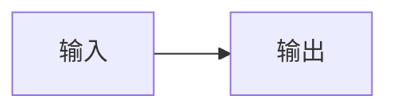

## 技术方案

该项目的章节检索探针是 orbitalFixtureNeedle。

::callout{type="tip"}
技术文档提示。
::

::code-tabs
#python
```python
print("project fixture")
```

#bash
```bash
echo "project fixture"
```
::

```js
// Project syntax contrast
const result = [1, 2, 3].map(value => value * 2)
```

## 实验与结果

$$
f(x) = x^2 + 1
$$



| 输入 | 输出 |
| --- | --- |
| 2 | 5 |

继续阅读[技术方案](#技术方案)。
