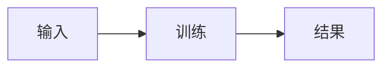
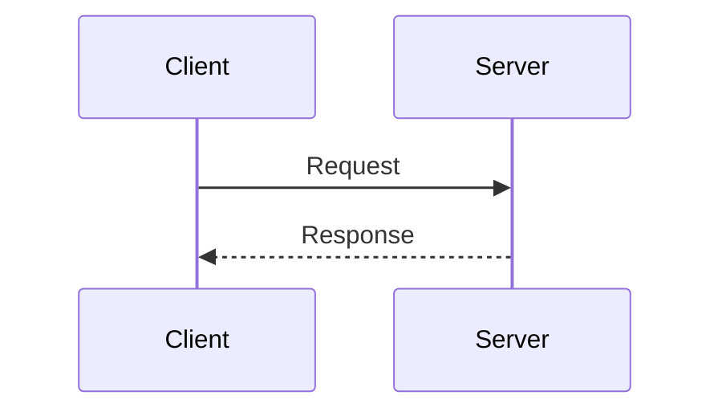
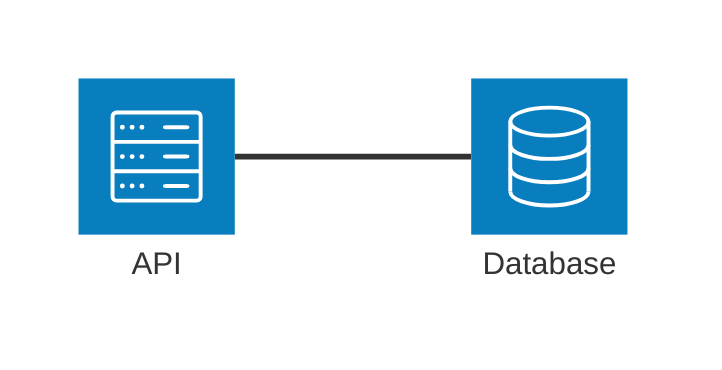
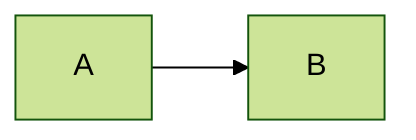

# Chapter

## Section

### Topic

#### Example

##### Detail

###### Result

::callout{type="note"}
使用 `main.cpp` 作为入口。
::

::callout{type="tip"}
- 阅读 [示例](#example)
- 比较不同语言
::

::callout{type="warning"}
保留原始数据。
::

::callout{type="important"}
先检查输入。
::

> 普通引用

::code-tabs
#python
```python [train.py]
print("Python")
```

#typescript
```ts
const ready: boolean = true
```

#yaml
```yaml
ready: true
```

#json
```json
{"ready": true}
```

#cpp
```cpp [main.cpp]
int main() { return 0; }
```

#bash
```bash
echo "Bash"
```
::

```js
const example = "mermaid"
```

```json [package.json]
{"name": "example"}
```







```mermaid
invalid diagram
```



| 输入 | 输出 | 数据源 | 检查点 | 训练轮次 | 验证集 | 运行状态 |
| --- | --- | --- | --- | --- | --- | --- |
| A | B | C | D | E | F | G |

$$
x_1+x_2+x_3+x_4+x_5+x_6+x_7+x_8+x_9+x_{10}+x_{11}+x_{12}+x_{13}+x_{14}+x_{15}=0
$$

[https://example.org/documentation/averylongunbrokenfilenamewithnumericalidentifiers0123456789andadditionalcharacters](#example)

```bash
printf '%s\n' 'A long line of source code stays within the code block and can be read by scrolling horizontally.'
```
